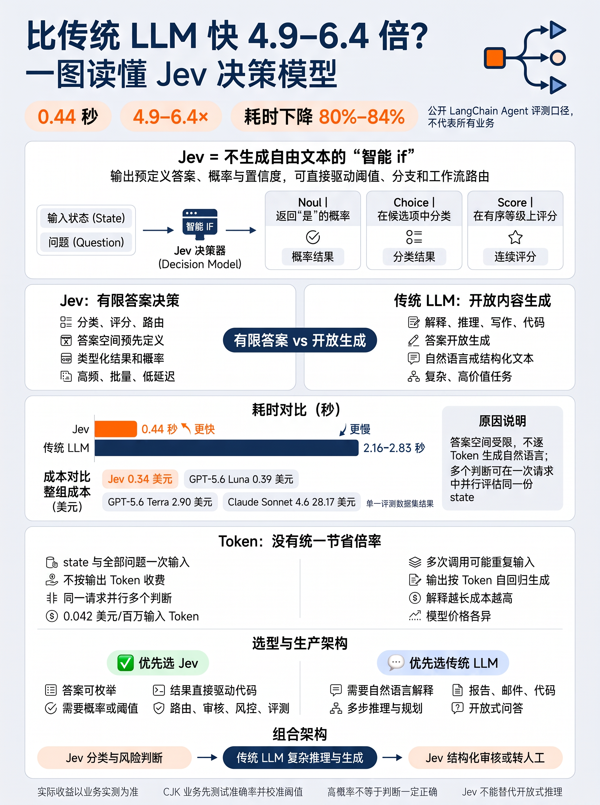
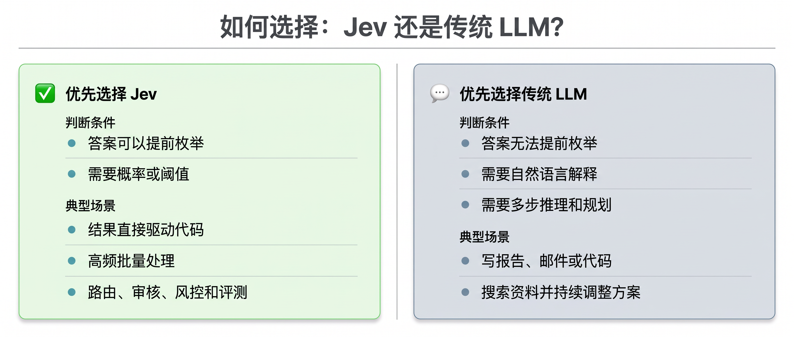

# 比传统 LLM 快 4\.9–6\.4 倍？一文读懂 Jev 决策模型

# 一图总结




**主要判断**

- **定位**：Jev 是决策模型，负责分类、评分和路由。

- **耗时**：公开评测中为 0\.44 秒，约快 4\.9–6\.4 倍。

- **Token**：没有通用倍率，优势集中在免输出 Token 计费。

- **选型**：有限答案用 Jev，开放生成用传统 LLM。

## 一、Jev 是什么

Jev 于 [2026 年 9 月 15 日](https://typesafe.ai/blog/introducing-system-one-models-and-jev)由 TypeSafe AI 公开发布，是其首个进入早期访问阶段的 System One 决策模型。输入是文本或结构化状态，输出是预先定义好的类型化答案、概率和置信度；它不生成自由文本。支持三类问题形式：

1. **Noul**：返回“是”的概率

2. **Choice**：在候选项中分类

3. **Score**：在有序等级上评分

它适合嵌入程序分支，充当“智能 if”：判断是否违规、属于哪个类别、风险多高、应该走哪个工作流。

传统 LLM 则更适合解释、推理、写作、代码生成和多轮对话。

---

## 二、使用示例

[LangChain TypeSafe](https://docs.langchain.com/oss/python/integrations/providers/typesafe)将 Jev 封装为 `TypeSafeClassifier`，它是一个标准 Runnable。一次调用可针对同一份 state 并行执行 Noul、Choice 和 Score，并把结果直接用于升级、路由和阈值判断。

下面这段示例把同一条客服消息同时交给 Choice、Score 和 Noul 三类问题评估；代码中的关键字段含义如下：

- **`state`**：待判断的业务上下文，同一份内容会被下方多个问题复用。

- **`questions`**：一次调用中要评估的问题集合；`department`、`frustration`、`is_urgent` 是自定义问题名，也是读取结果时使用的键。

- **`instructions`**：向模型说明当前问题要判断什么。

- **`criteria`**：限定答案空间。`Choice` 使用键值对定义类别及其含义，`Score` 使用有序列表定义从轻到重的评分锚点，`Noul` 使用 `true` 和 `false` 描述正、负判断标准。

- **返回格式**：`Choice` 从预设选项里选择并返回概率分布和置信度；`Score` 按有序等级打分，可返回两个等级之间的位置；`Noul` 返回是/否问题的概率，0 表示否，1 表示是。

```Python
import os

from dotenv import find_dotenv, load_dotenv
load_dotenv(find_dotenv(), override=True)
from langchain_typesafe import (
    Choice,
    Noul,
    NoulCriteria,
    Score,
    TypeSafeClassifier,
)
from rich import print as rich_print

jev_result = TypeSafeClassifier().invoke(
        {
            "state": "我的订阅今天又被扣费了两次，已经影响报销，请马上帮我处理。",
            "questions": {
                "department": Choice(
                    instructions="这条客服消息应该由哪个支持团队处理？",
                    criteria={
                        "billing": "支付、发票、退款、重复扣费、订阅相关问题",
                        "technical": "缺陷、故障、集成、API、产品错误相关问题",
                        "sales": "价格、升级、采购、新账号相关问题",
                    },
                ),
                "frustration": Score(
                    instructions="客户的沮丧或不满程度有多高？",
                    criteria=["平静", "有些不满", "明显沮丧", "非常愤怒"],
                ),
                "is_urgent": Noul(
                    instructions="这条消息是否需要紧急处理？",
                    criteria=NoulCriteria(
                        true="客户描述了时间压力、重复失败或严重影响",
                        false="客户可以等待，或只是咨询一般信息",
                    ),
                ),
            },
        }
    )
    
rich_print(jev_result)
```


```Python
ClassifierResponse(
    model='jev',
    answers={
        'department': ChoiceAnswer(
            type='choice',
            choice='billing',
            probabilities={
                'billing': 0.9795,
                'technical': 0.0091,
                'sales': 0.0114
            },
            confidence=0.9693
        ),
        'frustration': ScoreAnswer(
            type='score',
            score=2.038,
            legend={0: '平静', 1: '有些不满', 2: '明显沮丧', 3: '非常愤怒'},
            probabilities={0: 0.0456, 1: 0.206, 2: 0.4131, 3: 0.3353},
            confidence=0.3674
        ),
        'is_urgent': NoulAnswer(type='noul', noul=0.9284)
    },
    usage=Usage(input_tokens=139, output_tokens=256),
    request_id=None
)
```

**示例小结**：这次客服消息被判到 `billing`，紧急程度 `noul=0.9284`；`frustration=2.038` 表示情绪接近“明显沮丧”，尚未达到“非常愤怒”。

- **Score 不是离散标签**：`ScoreAnswer` 返回的 `2.038` 是有序等级数组上的连续位置，不是数组下标 `2` 或固定标签；读取时应结合 `legend` 和 `probabilities` 判断，不宜直接四舍五入。

- **置信度要单独看**：`frustration` 的最高概率为 `0.4131`，`confidence=0.3674`，说明模型有倾向但确定性不强；生产上应设置灰区和人工复核机制。

- **适用边界**：Jev 适合答案可枚举、结果可阈值化并直接驱动路由的判断；若需要解释原因、生成回复或完成复杂推理，仍应使用传统 LLM。

## 三、耗时和成本差异

性能差异取决于任务形态、输入长度、问题数量、模型和网络条件。

以下数字仅适用于对应测试口径，不能外推为所有业务的固定倍数。

**LangChain Agent 评测结果**

|方案|平均单次耗时|整组成本|相对 Jev|
|---|---|---|---|
|**Jev**|**0\.44 秒**|0\.34 美元|基线；单次约 0\.00035 美元|
|GPT\-5\.6 Luna|2\.16–2\.83 秒|0\.39 美元|成本约为 Jev 的 1\.15 倍|
|GPT\-5\.6 Terra|2\.16–2\.83 秒|2\.90 美元|成本约为 Jev 的 8\.5 倍|
|Claude Sonnet 4\.6|2\.16–2\.83 秒|28\.17 美元|成本约为 Jev 的 82\.9 倍|

同一测试中，Jev 的 0\.44 秒对比 LLM 的 2\.16–2\.83 秒，约快 **4\.9–6\.4 倍**，耗时下降约 80%–84%。这是单一 Agent 评测数据集的结果，不代表所有分类任务。

Jev 更快的核心原因是它执行分类、评分和路由等判别任务，答案空间预先限定，不需要像传统 LLM 一样逐 Token 生成自然语言。

多个判断还能在一次请求中并行评估同一份 state，减少重复输入、输出生成、结果解析和失败重试。

这类加速主要出现在有限答案任务中，不适用于开放式写作或复杂推理。

## 四、Token 差异

**Jev 与传统 LLM 没有统一的 Token 节省倍率。**两者都要读取 state 和问题，因此输入 Token 取决于实际数据；区别主要在输出机制和多问题处理方式。

|维度|Jev|传统 LLM|
|---|---|---|
|输入 Token|state 与全部问题；state 仅传入一次|上下文与提示词；多次调用可能重复输入|
|输出 Token|**不按输出 Token 收费**；返回类型化概率|按 Token 自回归生成，推理和解释越长越贵|
|多个判断|同一请求内并行评估|在一个 Prompt 中顺序生成，或拆成多次请求|
|计费单价|0\.042 美元/百万输入 Token|因模型而异，通常同时计输入和输出|
|上下文|默认每请求 64k、每问题 32k|因具体模型而异|

## 五、与传统 LLM 的区别

|维度|Jev|传统 LLM|
|---|---|---|
|核心任务|分类、评分、决策|问答、推理、写作、代码生成|
|答案空间|预先定义|开放生成|
|输出|类型化结果和概率|自然语言或结构化文本|
|程序接入|可直接用于阈值和分支|通常需要解析、校验和重试|
|解释能力|不生成完整解释|能生成自然语言解释|
|适合规模|高频、批量、低延迟决策|低频或高价值的复杂任务|

---

## 六、使用选择



生产系统常采用组合架构：Jev 先完成分类、风险判断和模型路由，传统 LLM 再处理复杂推理与内容生成，最后由 Jev 做结构化审核或决定是否转人工。

---

## 七、边界与风险

- 公开披露的最高加速与降本数据来自 TypeSafe 自有工作流基准，实际收益应以业务实测为准。

- Jev 当前以英文为主要训练语言。官方建议中文、日文和韩文（CJK）业务先用自身数据测试准确率，并据此校准置信度阈值。

- Jev 无法替代开放式推理和文本生成；需要书面解释时仍应使用传统 LLM。

- 概率高不等于业务判断一定正确，阈值应结合标注集、误报成本和漏报成本确定。

# 封面


