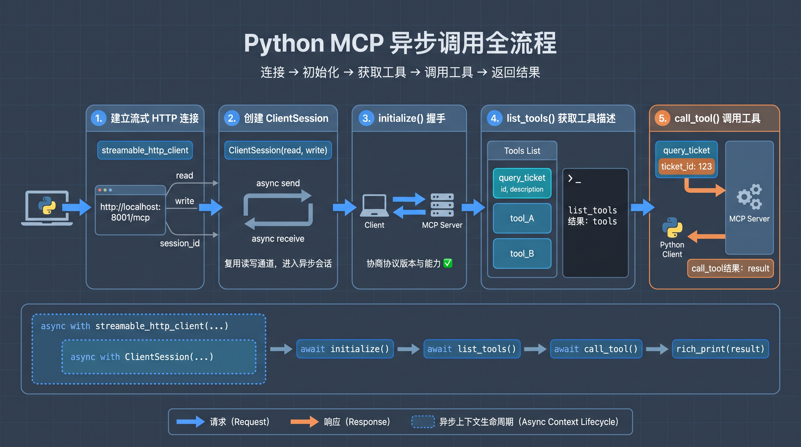
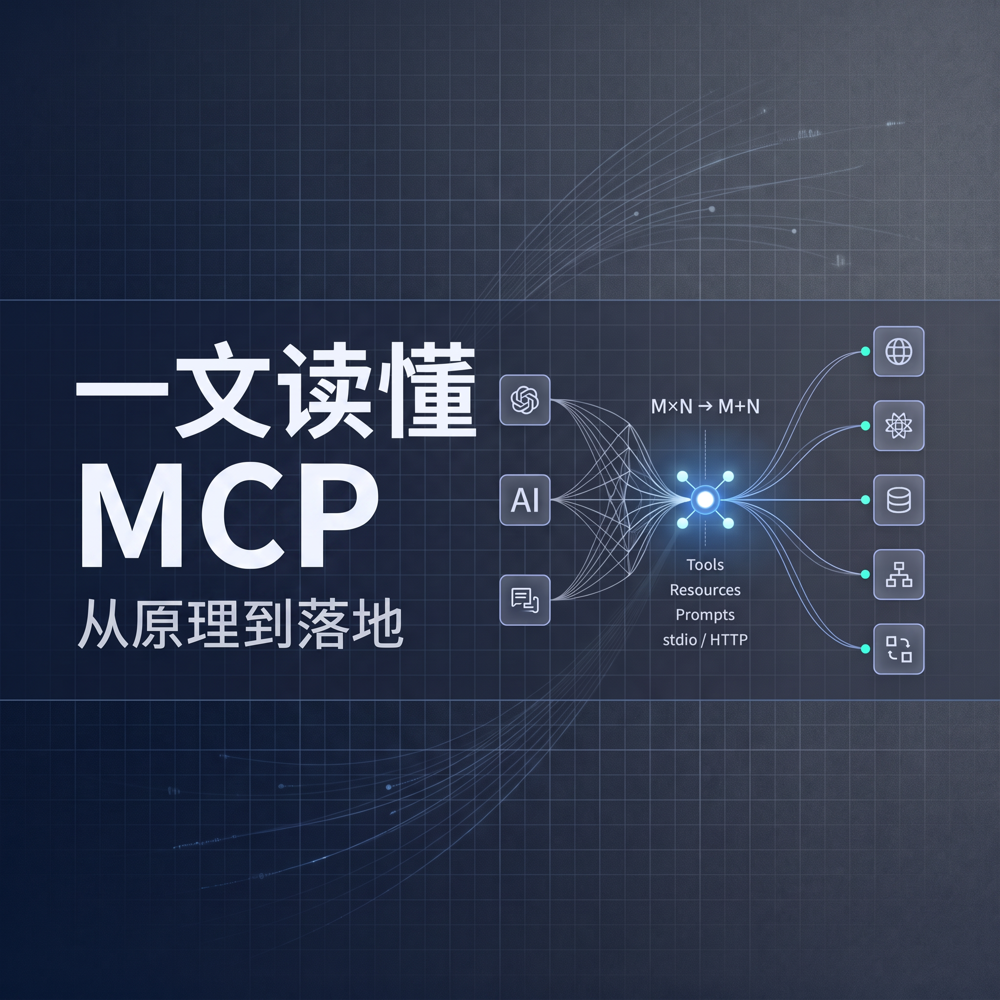

# 一文读懂MCP：从原理到落地

本文围绕 MCP 解决的工程集成问题展开，结合 FastMCP 示例串起服务端注册、客户端发现与调用、Tool / Resource / Prompt 三类能力、stdio 与 Streamable HTTP 传输选择，以及接入高德地图等实践案例，帮助你从原理到落地理解 MCP 的价值与边界。

# 什么是MCP

MCP（Model Context Protocol，模型上下文协议）是连接 AI 应用与外部系统的开放标准，由 Anthropic 于 2024 年 11 月 25 日发布并开源。

# MCP解决什么问题

> **MCP 不直接提升模型本身的推理能力，它解决的是工程集成问题**——让模型能以标准方式发现、读取和调用外部系统暴露的能力。
> 
> 

过去 AI 应用对接外部工具和系统，是典型的M×N 耦合难题：

假设你有 M 个不同的 AI 应用（通用对话机器人、RAG 检索系统、自定义智能体等），以及 N 个不同的工具 / 系统（GitHub、高德地图、各类数据库等），传统模式下每一对组合都要单独开发集成逻辑，总共需要做 M×N 套适配。这会导致跨团队重复造轮子、各套实现逻辑不统一、维护成本居高不下。

**MCP 通过提供统一的 API 层大幅简化复杂度，直接把 M×N 问题转化为M\+N 问题**：

工具侧开发者只需要为每个外部系统开发 1 个 MCP 服务端，总共 N 个；AI 应用侧开发者只需要为自己的应用实现 1 个 MCP 客户端，总共 M 个。


# 从一个例子讲起

上面说的都是概念，有点抽象，接下来咱们从一个例子讲解其原理

```python
from fastmcp import FastMCP

mcp = FastMCP("ticket_server")

@mcp.tool() # 通过此装饰器暴露工具
def query_ticket(ticket_id: str) -> str:
    """
    查询票信息:param ticket_id: 票号
    :return: 票信息
    """
    # 模拟查询票信息，真实情况是这里会查询数据库或调用API/RPC接口
    return f"ticket {ticket_id}: open"

if __name__ == '__main__':
    # 以 streamable-http 传输方式启动 MCP 服务，本机，端口 8001
    mcp.run("streamable-http", host="127.0.0.1", port=8001)

```

```python
import asyncio

from mcp import ClientSession
from mcp.client.streamable_http import streamable_http_client
from rich import print as rich_print

async def main() -> None:
    async with streamable_http_client("http://localhost:8001/mcp") as (read, write, session_id):
        async with ClientSession(read, write) as session:
            await session.initialize() # 握手，协商协议版本和能力

            tools = await session.list_tools() # 获取工具描述列表
            rich_print("list_tools结果：", tools)

            result = await session.call_tool( # 调用工具
                "query_ticket",
                arguments={"ticket_id": "123"},
            )
            rich_print("call_tool结果：", result)

if __name__ == "__main__":
    asyncio.run(main())
```

server启动后，运行上面的client可以得到下面的输出

```Python
list_tools结果：ListToolsResult(
    nextCursor=None,
    tools=[
        Tool(
            name='query_ticket',
            description='查询票信息:param ticket_id: 票号\n:return: 票信息',
            inputSchema={
                'properties': {'ticket_id': {'type': 'string'}},
                'required': ['ticket_id'],
            },
            outputSchema={
                'properties': {'result': {'type': 'string'}},
                'required': ['result'],
            },
        )
    ]
)
call_tool结果：CallToolResult(
    content=[
        TextContent(type='text', text='ticket 123: open', annotations=None, meta=None)
    ],
    structuredContent={'result': 'ticket 123: open'},
    isError=False
)
```

可以看到：

- list\_tools：查询服务端提供的工具列表，返回结果包含名称、描述、出入参等信息

- call\_tool：调用服务端提供的query\_ticket工具，返回调用结果

那么这个过程发生了什么呢？

# 代码解读

## 服务端注册工具，并暴露 /mcp 接口

服务端通过 @mcp\.tool\(\) 装饰器将 query\_ticket 函数注册到 FastMCP。保存形式是字典：

- key格式是“tool:query\_ticket@\{version\}”，由于没填version，因此version是空的，即key=tool:query\_ticket@

- value是`FunctionTool` 对象，包含其根据函数名\(name\)，docstring\(description\)，入参\(parameters\)，返回值\(output\_schema\)等生成的工具描述。客户端list\_tools返回的就是这些，结构大致如下：

```python
FunctionTool(
    key="tool:query_ticket@",
    name="query_ticket",
    version=None,
    description="查询票信息:param ticket_id: 票号\n:return: 票信息",
    parameters={
        "type": "object",
        "properties": {
            "ticket_id": {"type": "string"}
        },
        "required": ["ticket_id"],
        "additionalProperties": False
    },
    output_schema={
        "type": "object",
        "properties": {
            "result": {"type": "string"}
        },
        "required": ["result"],
        "x-fastmcp-wrap-result": True
    },
)
```

服务端通过下面的代码启动 HTTP 服务，默认 MCP 路径为 /mcp：传输格式是streamable\-http，监听127\.0\.0\.1的8001端口

```python
mcp.run("streamable-http", host="127.0.0.1", port=8001)
```

## 客户端代码解析

流程图如下：



### 创建传输通道

/mcp 是统一的协议入口。URL（http://localhost:8001/mcp）确定“连接哪个 MCP 服务”。下面讲到的tools/list等请求都发到这个地址，由消息中的 method 区分操作。

```python
async with streamable_http_client("http://localhost:8001/mcp") as (read, write, session_id):
```

SDK 将 HTTP 通信封装成消息流，供 ClientSession 使用：

|返回值|用途|
|---|---|
|read|接收服务端的 MCP 消息。|
|write|发送 MCP 消息给服务端。|
|session\_id|获取会话 ID 的函数，这里未使用。|

### ClientSession 按 MCP 协议发现、调用工具


```python
async with ClientSession(read, write) as session:
    await session.initialize() # 握手，协商协议版本和能力

    tools = await session.list_tools() # 获取工具描述列表
    rich_print("list_tools结果：", tools)

    result = await session.call_tool( # 调用工具
        "query_ticket",
        arguments={"ticket_id": "123"},
    )
    rich_print("call_tool结果：", result)
```

1\) initialize\(\) 完成初始化握手。

2\) list\_tools\(\) 通过上述通道发送 JSON\-RPC请求，其核心内容类似下面的示例（请求 ID 仅作示意）：

```json
{
  "jsonrpc": "2.0",
  "id": 2,
  **"method": "tools/list",**
  "params": {}
}
```

FastMCP 收到 tools/list 后，返回已注册工具的名称、描述、inputSchema 等信息。返回值里的`nextCursor=None` 表示没有下一页。 这个 SDK\(版本 mcp\>=1\.24,\<2\) 方法不会自动取完所有分页 ，需要完整目录时可以这样写：

```Python
from mcp.types import PaginatedRequestParams

all_tools = []
params = None

while True:
    page = await session.list_tools(params=params)
    all_tools.extend(page.tools)

    if page.nextCursor is None:
        break

    params = PaginatedRequestParams(cursor=page.nextCursor)
```

3\) 调用 call\_tool\(\) 时，SDK 发送 tools/call 请求；服务端根据工具名称找到 query\_ticket，传入 ticket\_id 并执行，然后将结果返回客户端。其核心内容类似下面的示例（请求 ID 仅作示意）：

```JSON
{
    "jsonrpc": "2.0",
    "id": 2,
    "method": "tools/call",
    "params": {
      "name": "query_ticket",
      "arguments": {
        "ticket_id": "123"
      }
    }
}
```

# 三类外部能力

MCP 不只支持通过 `@mcp.tool()` 注册工具，还能暴露静态资源和提示模板：

|能力类型|说明|
|---|---|
|工具（Tools）|封装可执行的函数或 API，例如查询天气、更新工单。agent可根据上下文调用，部分工具会产生副作用。|
|资源（Resources）|向客户端提供可读取的上下文，例如文档、配置和状态说明。通常只读，不承担复杂计算，也不产生副作用。|
|提示模板（Prompts）|封装可复用的提示与参数，用于规定任务输入和交互方式。由用户显式选择，客户端获取后再交给模型。|

下面是 Resource 和 Prompt 例子：

```Python
from fastmcp import FastMCP

mcp = FastMCP("ticket_server")

# Resource：提供可读取的上下文数据，通过 URI 标识；这里的 URI 不是 HTTP 路由。
# 客户端通过 read_resource("ticket://status-guide") 读取。
@mcp.resource("ticket://status-guide")
def ticket_status_guide() -> str:
    """票状态说明，供客户端读取并作为模型的参考资料。"""
    return (
        "票状态说明：\n"
        "- open：待处理。\n"
        "- in_progress：处理中。\n"
        "- closed：已关闭。\n"
        "回复用户时应说明当前状态，不要编造处理进度或完成时间。"
    )

# Prompt：提供可复用的提示词模板，客户端通过 get_prompt(...) 获取。
# 获取模板只会返回消息，不会自动调用工具、读取资源或请求大模型。
@mcp.prompt()
def reply_ticket(ticket_id: str, ticket_info: str, status_guide: str) -> str:
    """根据票号、已查询的票信息和状态说明，生成客服回复提示词。

    Args:
        ticket_id: 票号，例如 123。
        ticket_info: query_ticket 工具返回的票信息。
        status_guide: ticket://status-guide 资源返回的状态说明。
    """
    return (
        "请根据以下资料，用简洁、友好的中文回复查询票状态的用户。\n"
        "仅根据资料说明状态，未知信息请明确告知，不要编造。\n\n"
        f"票号：{ticket_id}\n"
        f"票信息：{ticket_info}\n"
        f"状态说明：\n{status_guide}"
    )

if __name__ == '__main__':
    # 以 streamable-http 传输方式启动 MCP 服务，监听端口 8001
    # MCP 客户端通过 http://localhost:8001/mcp 访问 tools、resources 和 prompts
    mcp.run("streamable-http", host="127.0.0.1", port=8001)

```

```Python
import asyncio

from mcp import ClientSession
from mcp.client.streamable_http import streamable_http_client
from rich import print as rich_print

async def main() -> None:
    async with streamable_http_client("http://localhost:8001/mcp") as (read, write, _):
        async with ClientSession(read, write) as session:
            await session.initialize()
            # Resource：列出资源，再通过 URI 读取状态说明。
            rich_print(await session.list_resources())
            resource = await session.read_resource("ticket://status-guide")
            rich_print(resource)

            # Prompt：将工具结果和资源内容填入模板，获取可发送给模型的消息。
            rich_print(await session.list_prompts())
            prompt = await session.get_prompt(
                "reply_ticket",
                arguments={
                    "ticket_id": "123",
                    "ticket_info": result.content[0].text,
                    "status_guide": resource.contents[0].text,
                },
            )
            rich_print(prompt)
            # 此处只打印提示词；真正生成客服回复还需要客户端调用大模型。

if __name__ == "__main__":
    asyncio.run(main())

```

# 三种核心角色

从上面的例子可以看出，MCP 定义了标准的客户端 \- 服务端架构，核心角色包括：

|角色|说明|
|---|---|
|宿主（Host）|用户直接交互的上层应用，比如 Claude 桌面端、Cursor 这类 IDE、自定义开发的智能体程序。|
|客户端（Client）|运行在宿主应用内部，负责和单个 MCP 服务端建立连接，每个客户端与对应服务端保持 1:1 的连接关系。|
|服务端（Server）|独立运行的外部程序，通过标准 API 经客户端向 AI 模型暴露 tools、resources、prompts 等能力，比如：文件系统、数据库、代码仓库、业务 API 包装层。|


# 两种传输方式：stdio 与 Streamable HTTP

细心的小伙伴会发现服务端有这样一行代码：mcp\.run\("streamable\-http", host="127\.0\.0\.1", port=8001\)，注释说它以 streamable\-http 传输方式启动。点开 run 方法会看到 transport 支持 stdio、http、streamable\-http、sse 4个取值。有什么区别和联系？

|参数|启动后发生什么|使用时机|
|---|---|---|
|stdio|本质是“客户端托管的子进程 \+ 标准流通信”，消息按行编码为 JSON\-RPC：<br>1. Host/Client 向 Server 的 stdin 写入请求或通知。<br>2. Server 从 stdin 逐行读取 JSON\-RPC 消息并执行业务逻辑。<br>3. Server 将响应或协议通知写回 stdout。<br>4. Host/Client 从 stdout 读回结果，并负责在关闭会话时结束子进程。|适合本机、单用户、由客户端按需拉起的场景，比如：本地工具、桌面应用、IDE 插件、文件系统 Server、本机 CLI 封装。<br>优点是无需端口和网络暴露。<br>注意：普通日志、调试信息就不要输出到控制台了，否则会污染协议流。|
|streamable\-http/http<br>|1. Server 作为独立 HTTP 服务运行，暴露单一 MCP endpoint，通常是 `/mcp`。<br>2. Client 将每个 JSON\-RPC 请求或通知作为 HTTP POST 发送到该 endpoint。<br>3. 如果是请求，Server 可返回一次性 JSON，也可返回与该请求绑定的 SSE 流，用于进度通知、流式结果等；通知类消息通常返回 `202 Accepted`。<br>4. 2025 版协议还支持 `GET /mcp` 建立独立 SSE 接收流；2026\-07\-28 版已移除该 GET 流，长连接通知改由请求级 SSE 或订阅请求承载。|适合远程 MCP Server、企业工具平台、多客户端连接、云端服务化和生产部署。<br>是新建网络型 MCP 服务的推荐选择。<br>FastMCP 中 `http` 与 `streamable-http` 都指向 Streamable HTTP。|
|sse|1. Server 启动旧版 HTTP\+SSE 服务。<br>2. Client 先 `GET /sse` 建立服务端到客户端的长连接。<br>3. Server 通过 `endpoint` 事件告知 Client 发送消息的 POST 地址，通常是带会话参数的 `/messages/`。<br>4. Client 向该地址 POST 请求；Server 再通过既有 SSE 长连接返回响应和通知。|仅用于兼容旧客户端或旧服务端。<br>作为独立传输已废弃，新项目不要再选，已有实现应迁移到 Streamable HTTP。|

> MCP 标准层面推荐的标准传输是 `stdio` 与 `Streamable HTTP`，
> 
> 

`Streamable HTTP` 并非抛弃 SSE，而是以统一、按需流式且更易扩展的 HTTP 传输模型，取代旧的 **HTTP \+ SSE 双通道架构**。

|对比维度|旧 HTTP \+ SSE|Streamable HTTP|
|---|---|---|
|通信模型|`GET /sse` 接收消息，另用 `POST` 发送消息（通常为/messages/），双通道协同。|统一使用 `/mcp` 端点，通过 HTTP 方法完成通信。|
|响应方式<br>|依赖长期 SSE 连接。|普通请求返回 JSON，需要流式传输时按需返回 SSE。|
|会话与扩容|需维护连接与会话映射，常依赖粘性会话或共享状态。|可有状态也可无状态，可用 `Mcp-Session-Id` 管理会话，更易水平扩容。|
|简单请求|一次 RPC 也要先建立持久 SSE 通道。|可直接完成一次性请求，无需维持长连接。|
|基础设施与恢复|代理兼容性不稳定，断线重连与消息重放需额外处理。|更适配鉴权、网关和负载均衡，并支持断线恢复与消息重放。|
|SSE 的角色|必须长期存在的独立传输通道。|按需使用的流式响应格式，不再是独立必选通道。|


下面是以stdio传输方式启动的例子

```Python
from fastmcp import FastMCP

mcp = FastMCP("config_server")

@mcp.tool()
def read_project_config(name: str) -> str:
    """
    读取项目配置:param name: 项目名称
    :return: 项目配置
    """
    return f"config for {name}"

if __name__ == "__main__":
    # Host 启动该进程后，通过 stdin/stdout 与它交换 MCP 消息
    mcp.run(transport="stdio")

```

```Python
import asyncio
import sys
from pathlib import Path

from mcp import ClientSession, StdioServerParameters
from mcp.client.stdio import stdio_client
from rich import print as rich_print

async def main():
    server_params = StdioServerParameters(
        command=sys.executable,
        args=[str(Path(__file__).resolve().with_name("server.py"))],
    )

    async with stdio_client(server_params) as (read, write):
        async with ClientSession(read, write) as session:
            await session.initialize()

            tools = await session.list_tools()
            rich_print(tools)

            result = await session.call_tool(
                "read_project_config",
                arguments={"name": "mcp"},
            )
            rich_print(result)
                                          
if __name__ == "__main__":
    asyncio.run(main())

```

# 实际使用案例：接入高德地图

上面讲了demo，核心角色，外部能力，传输方式，那么实际是怎么使用的呢？如果有多个MCP server怎么办？

```Python
import asyncio
import os
from urllib.parse import urlencode

from dotenv import load_dotenv, find_dotenv
from pydantic import SecretStr

load_dotenv(find_dotenv(), override=True)
from langchain.agents import create_agent
from langchain.chat_models import init_chat_model
from langchain_mcp_adapters.client import MultiServerMCPClient

from rich import print as rich_print

# 高德地图的api_key 从https://console.amap.com/dev/key/app获取
# 用来识别用户身份，做审计等
AMAP_API_KEY = os.getenv("AMAP_API_KEY")
# deepseek的api_key 从https://platform.deepseek.com/获取
DEEPSEEK_API_KEY = os.getenv("DEEPSEEK_API_KEY")

def build_amap_mcp_url() -> str:
    """
    根据高德官方格式构造 Streamable HTTP MCP 地址。

    使用 urlencode，而不是直接进行字符串拼接。
    注意：不要打印该 URL，否则可能泄露高德 Key。
    """
    query_string = urlencode({"key": AMAP_API_KEY})
    return f"https://mcp.amap.com/mcp?{query_string}"

async def main() -> None:
    model = init_chat_model(
        model="DeepSeek-V4.1-Flash",
        model_provider="deepseek",
        api_key=SecretStr(DEEPSEEK_API_KEY),
    )
    mcp_config = {
        # 这里可以配置多个 MCP 服务，每个服务可以提供多个工具。
        "amap": { # 高德MCP接入说明 https://lbs.amap.com/api/mcp-server/gettingstarted
            "url": build_amap_mcp_url(),
            "transport": "http",
        },
    }

    # 客户端自动管理会话，并为工具名添加服务名前缀，避免同名冲突。内部封装了官方 MCP Python SDK 的`mcp.ClientSession`
    client = MultiServerMCPClient(mcp_config, tool_name_prefix=True)
    tools = await client.get_tools()
    
    agent = create_agent(
        model=model,
        tools=tools,
        system_prompt="""
你是一个使用高德地图 MCP 工具的出行规划助手。

请遵循以下规则：
1. 涉及地址、地点、坐标、距离、天气或路线时，优先调用高德 MCP 工具。
2. 不要凭记忆猜测坐标、距离、行驶时间或路线。
3. 地点存在歧义时，先使用地点搜索工具确认；仍无法确认时再询问用户。
4. 规划路线时，应先确认起点和终点，再选择对应的驾车、步行、骑行或公交工具。
5. 最终回答应简洁说明距离、预计时间、推荐方案和必要注意事项。
6. 路线和时间可能受实时交通影响，应提醒用户以实际导航为准。
7. 不得输出、复述或泄露任何 API Key、MCP 连接地址或认证信息。
""",
    )

    question = "帮我规划从北京南站到故宫博物院的驾车路线，并说明距离和预计时间。"

    result = await agent.ainvoke(
        {
            "messages": [
                {
                    "role": "user",
                    "content": question,
                }
            ]
        }
    )

    rich_print("agent全部返回：", result)
    final_message = result["messages"][-1]
    rich_print("最终回答：", final_message.content)

if __name__ == "__main__":
    asyncio.run(main())

```

打印结果

```Python
agent全部返回：
{
    'messages': [
        HumanMessage(
            content='帮我规划从北京南站到故宫博物院的驾车路线，并说明距离和预计时间。',
        ),
        AIMessage(
            tool_calls=[
                {
                    'name': 'amap_maps_geo',
                    'args': {'address': '北京南站', 'city': '北京'},
                    'id': 'call_md2e18v7H8LaLmfqwOvBjslC',
                    'type': 'tool_call'
                },
                {
                    'name': 'amap_maps_geo',
                    'args': {'address': '故宫博物院', 'city': '北京'},
                    'id': 'call_XFxufDvUkrwZRWG1fX2N0YxB',
                    'type': 'tool_call'
                }
            ],
        ),
        ToolMessage(
            content=[
                {
                    'type': 'text',
                    'text': 
'{"results":[{"country":"中国","province":"北京市","city":"北京市","citycode":"010","dist
rict":"丰台区","street":[],"number":[],"adcode":"110106","location":"116.378059,39.867679
","level":"公交地铁站点"}]}',
                    'id': 'lc_633a4b6d-0e69-4133-b3b8-2639c15421f7'
                }
            ],
            name='amap_maps_geo',
        ),
        ToolMessage(
            content=[
                {
                    'type': 'text',
                    'text': 
'{"results":[{"country":"中国","province":"北京市","city":"北京市","citycode":"010","dist
rict":"东城区","street":[],"number":[],"adcode":"110101","location":"116.392773,39.914836
","level":"兴趣点"}]}',
                    'id': 'lc_6fb0a425-eb18-4652-a310-e896b013e5d0'
                }
            ],
            name='amap_maps_geo',
        ),
        AIMessage(
            tool_calls=[
                {
                    'name': 'amap_maps_direction_driving',
                    'args': {
                        'origin': '116.378059,39.867679',
                        'destination': '116.392773,39.914836'
                    },
                    'id': 'call_Tu7IF9yvfq9oCWq9KmoGhdbu',
                    'type': 'tool_call'
                }
            ],
        ),
        ToolMessage(
            content=[
                {
                    'type': 'text',
                    'text': 
'{"origin":"116.378059,39.867679","destination":"116.392773,39.914836","paths":[{"path":"
","distance":"7657","duration":"1258","steps":[{"instruction":"沿南站幸福路途径马家堡东路
、太平街向东北行驶2.5千米右转","road":"南站幸福路","distance":"2472","orientation":"东北"
,"duration":"330"},{"instruction":"沿北纬路向东行驶231米左转","road":"北纬路","distance":
"231","orientation":"东","duration":"55"},{"instruction":"沿西经路途径万明路向北行驶672米
右转进入主路","road":"西经路","distance":"672","orientation":"北","duration":"122"},{"ins
truction":"沿珠市口西大街途径珠市口东大街向东行驶975米左转","road":"珠市口西大街","distan
ce":"975","orientation":"东","duration":"164"},{"instruction":"沿前门东路途径广场东侧路向
北行驶1.7千米左转","road":"前门东路","distance":"1740","orientation":"北","duration":"371
"},{"instruction":"沿西长安街向西行驶645米右转","road":"西长安街","distance":"645","orien
tation":"西","duration":"63"},{"instruction":"沿南长街向北行驶806米右转","road":"南长街",
"distance":"806","orientation":"北","duration":"115"},{"instruction":"沿西华门大街向东行
驶116米到达目的地","road":"西华门大街","distance":"116","orientation":"东","duration":"38
"}]}]}',
                    'id': 'lc_510ec4db-7c79-4441-93ce-f6a6ee4f7109'
                }
            ],
        ),
        AIMessage(
            content='从北京南站到故宫博物院驾车路线：\n\n- 距离：约 7.7 公里\n- 
预计时间：约 21 分钟\n- 
推荐路线：北京南站出发，经南站幸福路、马家堡东路、太平街、珠市口西/东大街、前门东路、广场
东侧路、西长安街、南长街，最后到达故宫博物院附近。\n\n注意事项：\n- 
故宫周边道路管制和停车限制较多，建议提前确认停车点。\n- 
预计时间会受实时交通、限行和景区周边管控影响，请以高德实时导航为准。',
        )
    ]
}

最终回答： 从北京南站到故宫博物院驾车路线：

- 距离：约 7.7 公里
- 预计时间：约 21 分钟
- 
推荐路线：北京南站出发，经南站幸福路、马家堡东路、太平街、珠市口西/东大街、前门东路、广场
东侧路、西长安街、南长街，最后到达故宫博物院附近。

注意事项：
- 故宫周边道路管制和停车限制较多，建议提前确认停车点。
- 预计时间会受实时交通、限行和景区周边管控影响，请以高德实时导航为准。
```

> 从最终结果可以确认，Agent 并不是凭模型记忆生成路线，而是根据高德 MCP 工具返回的查询结果组织回答。MCP 负责以统一协议暴露高德能力，Agent 则负责选择工具、组装参数并整合结果。
> 
> 


主要流程可以概括为：

1. 应用启动时，`MultiServerMCPClient` 连接 MCP Server，通过 `get_tools()` 获取工具的名称、描述和入参 Schema，再把工具列表传给 Agent。

2. 用户提出路线规划问题后，deepseek结合问题与工具描述决定调用amap\_maps\_geo工具，并生成请求参数，目的是获取北京南站和故宫博物院地理坐标

3. Agent 生成工具调用请求，由 MCP Client 转发给高德服务。

4. 高德服务返回北京南站和故宫博物院地理坐标。

5. 模型结合问题与工具描述决定调用amap\_maps\_direction\_driving工具，并生成请求参数（主要是北京南站和故宫博物院地理坐标）

6. Agent 生成工具调用请求，由 MCP Client 转发给高德服务。

7. 高德服务返回距离、预计时间和路线等结构化结果

8. Agent 将这些结果追加到对话上下文，再由deepseek生成最终回答。信息不足时，这个过程还可能继续循环，形成“判断 → 调用 → 获取结果 → 再判断”的执行链路。至于 Agent 内部如何完成工具选择、参数生成和多轮调用，下期再展开。

# MCP优势与局限

> MCP 的最大误区是把协议标准化等同于安全标准化。官方安全文档强调，MCP 实现需要额外考虑授权流程、攻击向量和最佳实践
> 
> 

**优势**

- 降低重复集成成本。

- 提升工具和上下文的复用性。

- 让模型、Host、Server 的边界更清楚。

- 更适合做 Agent 工具生态。

**局限**

- 不会自动解决权限治理。

- 无法天然防止提示注入。

- Server 可信来源需要管理。

- 生产落地仍依赖审计和监控。

# 封面




