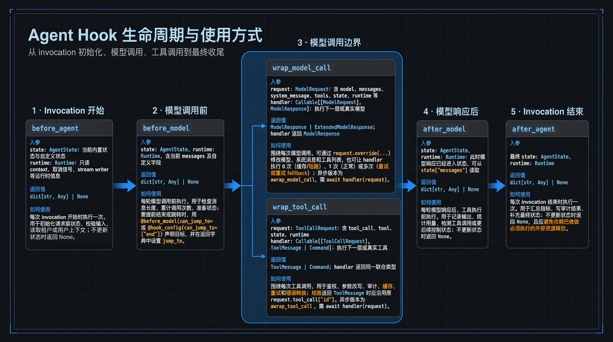

# LangChain 中间件之字段详解

前文讲述了LangChain中间件方法的执行顺序

咱们今天讲解一下字段详解



**建议保存此图，方便以后查阅**。

友情提示：电脑查看体验更佳

# 从一个例子讲起：两种组织方式

下面把继承写法和 Decorator 写法放在同一个示例中对照。两者都实现同一需求：

1. 每次模型调用前打印消息数

2. 模型调用失败时最多尝试 3 次。

```python
from typing import Callable

from langchain.agents import create_agent
from langchain.agents.middleware import (
    AgentMiddleware,
    AgentState,
    ModelRequest,
    ModelResponse,
    before_model,
    wrap_model_call,
)
from langgraph.runtime import Runtime


# 写法一：继承 AgentMiddleware，把多个 hook 和配置收拢到一个对象中
class RetryLoggingMiddleware(AgentMiddleware):
    def __init__(self, max_retries: int = 3) -> None:
        self.max_retries = max_retries

    def before_model(
        self,
        state: AgentState,
        runtime: Runtime,
    ) -> dict | None:
        print(f"即将调用模型，消息数: {len(state['messages'])}")
        return None

    def wrap_model_call(
        self,
        request: ModelRequest,
        handler: Callable[[ModelRequest], ModelResponse],
    ) -> ModelResponse:
        for attempt in range(self.max_retries):
            try:
                return handler(request)
            except Exception:
                if attempt == self.max_retries - 1:
                    raise
                print(f"模型调用失败，准备第 {attempt + 2} 次调用")


class_agent = create_agent(
    model="openai:gpt-4o-mini",
    tools=[],
    middleware=[RetryLoggingMiddleware(max_retries=3)],
)


# 写法二：用 Decorator 把无共享状态的 hook 拆成独立函数
MAX_RETRIES = 3


@before_model
def log_before_model(
    state: AgentState,
    runtime: Runtime,
) -> dict | None:
    print(f"即将调用模型，消息数: {len(state['messages'])}")
    return None


@wrap_model_call
def retry_model(
    request: ModelRequest,
    handler: Callable[[ModelRequest], ModelResponse],
) -> ModelResponse:
    for attempt in range(MAX_RETRIES):
        try:
            return handler(request)
        except Exception:
            if attempt == MAX_RETRIES - 1:
                raise
            print(f"模型调用失败，准备第 {attempt + 2} 次调用")


decorator_agent = create_agent(
    model="openai:gpt-4o-mini",
    tools=[],
    middleware=[log_before_model, retry_model],
)
```

- `before_model` 只能在模型调用前读取或更新 state；真正的重试必须放在 `wrap_model_call`，因为只有它拿得到 `handler`，可以决定调用模型多少次。

- `middleware` 列表中靠前的 wrap middleware 位于外层。多个重试、缓存、fallback 同时存在时，顺序会影响谁先拦截请求、谁能看到异常。

**两种写法怎么选：**

- 只有一个简单、无状态的 hook 时，Decorator 写法更短，适合日志、轻量校验和简单改写。

- 同一 middleware 要覆盖多个阶段，或者需要配置参数、共享状态时，继承写法更清晰，此写法还可以按需实现对应的异步 Hook，不需要全部实现。

注意：被`@before_model` 装饰后，`log_before_model` 已经不是原始函数了，而是一个动态创建出来的`AgentMiddleware` 实例。

那咱们下面就看看这个AgentMiddleware

# AgentMiddleware结构

`AgentMiddleware` 是 LangChain Agent 中间件的扩展基类。

从 API 结构看，`AgentMiddleware` 主要提供：

1. 四个可覆写的类属性：`state_schema`、`tools`、`trace_policy`、`transformers`；

2. 六类核心 Hook：`before_agent`、`before_model`、`after_model`、`after_agent`、`wrap_model_call`、`wrap_tool_call`。

前四个是 node\-style Hook，在固定生命周期节点顺序执行，适合校验、日志和状态更新；

后两个是 wrap\-style Hook，包裹一次模型或工具调用，可决定底层 `handler` 调用 0 次、1 次或多次，因此适合短路、缓存、重试、降级和请求/响应改写。。

```Python
class AgentMiddleware(Generic[StateT, ContextT, ResponseT]):
    state_schema: type[StateT] = cast("type[StateT]", _DefaultAgentState)  # 传给中间件节点的状态结构
    tools: Sequence[BaseTool]  # 由该中间件额外注册的工具
    trace_policy: TracePolicy | None = None  # 钩子 span 的可选追踪策略
    transformers: Sequence[TransformerFactory] = ()  # 由该中间件注册的流转换器工厂

    # Agent 开始执行前运行一次，可返回状态更新
    def before_agent(self, state: StateT, runtime: Runtime[ContextT]) -> dict[str, Any] | None: ...

    # 每次调用模型前运行，可检查或更新状态
    def before_model(self, state: StateT, runtime: Runtime[ContextT]) -> dict[str, Any] | None: ...

    # 每次模型返回后运行，可读取结果并更新状态
    def after_model(self, state: StateT, runtime: Runtime[ContextT]) -> dict[str, Any] | None: ...

    # Agent 执行结束后运行一次，可返回最终状态更新
    def after_agent(self, state: StateT, runtime: Runtime[ContextT]) -> dict[str, Any] | None: ...

    # 包裹模型调用，可改写请求、重试、短路或改写响应
    def wrap_model_call(self, request: ModelRequest[ContextT], handler: Callable[[ModelRequest[ContextT]], ModelResponse[ResponseT]]) -> ModelResponse[ResponseT] | AIMessage | ExtendedModelResponse[ResponseT]: ...

    # 包裹工具调用，可修改请求、重试、监控或改写结果
    def wrap_tool_call(self, request: ToolCallRequest, handler: Callable[[ToolCallRequest], ToolMessage | Command[Any]]) -> ToolMessage | Command[Any]: ...
```

# AgentMiddleware 四个类属性

`state_schema`、`tools`、`trace_policy`、`transformers`这四个不是函数入参，而是 `AgentMiddleware` 子类可以覆写的类属性。

它们在 `create_agent()` 编译 agent graph 时被读取，用来扩展状态、注册工具、控制 trace 记录以及注册 stream transformer。

## 1\. state\_schema：声明 middleware 需要的状态结构

`state_schema` 定义传给 middleware hook 的 agent state schema。默认是 `_DefaultAgentState`（继承自：AgentState），只包含基础的 `messages`，jump\_to，structured\_response字段。只有当 middleware 需要新增自定义状态字段时才需要覆写。

注：JumpTo = Literal\["tools", "model", "end"\]，即目标只有三种，工具调用，模型调用，结束

```Python
class AgentState(TypedDict, Generic[ResponseT]):
    messages: Required[Annotated[list[AnyMessage], add_messages]]
    jump_to: NotRequired[Annotated[JumpTo | None, EphemeralValue, PrivateStateAttr]]
    structured_response: NotRequired[Annotated[ResponseT, OmitFromInput]]

```

它在 `create_agent` 中会和其他 middleware 的 state schema 以及用户显式传入的 `state_schema` 合并，最后作为 `StateGraph(state_schema=...)` 的 schema。详细讲解和源码如下：

1. 合并所有middleware的state\_schema和base\_state\(入参的state\_schema或者AgentState\)，注：base\_state放在最后

2. 遍历schemas，组装成schema\_hints，类型为dict\[type, dict\[str, Any\]\]（逐层含义为：类型\-字段名\-字段类型注解等信息），这里先pop，后放，因此后面的会覆盖前面的，**base\_state是后放的，会覆盖前面的同名字段**

3. 生成三个不同用途的TypedDict（`StateSchema`，`InputSchema`，`OutputSchema`），关键点是：这三个 schema 都来自同一批字段，但过滤规则不同。

`StateSchema` 不传`omit_flag` ，所以包含所有字段，作为 agent graph 内部运行状态。

`InputSchema` 传`"input"` ，所以会过滤掉被标记为`OmitFromSchema(input=True)` 的字段，也就是不希望调用方输入的内部字段。

`OutputSchema` 传`"output"` ，所以会过滤掉被标记为`OmitFromSchema(output=True)` 的字段，也就是不希望最终暴露给调用方的内部字段。

```python
# 初始化为入参的state_schema或者AgentState
base_state = state_schema if state_schema is not None else AgentState
# 合并所有middleware的state_schema以及base_state=入参的state_schema或者AgentState
state_schemas = [*(m.state_schema for m in middleware), base_state]
# 合并解析成 LangGraph`StateGraph` 需要的三个 schema：
resolved_state_schema, input_schema, output_schema = _resolve_schemas(state_schemas)

def _resolve_schemas(schemas: list[type]) -> tuple[type, type, type]:
    schema_hints: dict[type, dict[str, Any]] = {}
    for schema in schemas:
        # 如果同一个 schema 类型重复出现，会先`pop` 再插入
        # 这是为了保证字典的遍历顺序体现“最后一次出现的位置”。后面合并字段时，顺序很重要。
        schema_hints.pop(schema, None)
        # 对每个 schema 取类型注解，也就是字段名和字段类型，比如`messages: list[...]` 、`structured_response: ...`
        schema_hints[schema] = _get_schema_type_hints(schema)
    # 调用`_resolve_schema` 生成三个不同用途的`TypedDict`
    return (
        _resolve_schema(schema_hints, "StateSchema", None), # 图内部完整状态 schema
        _resolve_schema(schema_hints, "InputSchema", "input"),# 外部调用 graph 时允许输入的 schema
        _resolve_schema(schema_hints, "OutputSchema", "output"),# graph 执行结束后对外输出的 schema
    )
```

一句话总结：`_resolve_schemas` 是 agent 工厂里的 schema 合并器，负责把 middleware schema 和基础 agent state 合成最终的内部状态、外部输入、外部输出三套`TypedDict` 。

## 2\. tools：由 middleware 额外注册工具

`tools` 是 middleware 额外暴露给 agent 的工具列表。它会和 `create_agent(tools=[...])` 传入的普通工具一起放入 `ToolNode`。

```python
# 收集所有middleware 注册的tools
# 内置例子包括 TodoListMiddleware、ShellToolMiddleware、FileSearchMiddleware 等，它们都通过 self.tools = [...] 注册额外工具
middleware_tools = [t for m in middleware for t in getattr(m, "tools", [])] 
# 字典格式的工具，认为是 provider 内置工具（built_in_tools），也就是模型服务商自己执行的工具。它们不会放进本地`ToolNode` 执行
built_in_tools = [t for t in tools if isinstance(t, dict)] 
# 非字典格式工具，比如`BaseTool` 、普通 Python callable。它们会进入`ToolNode` ，由 LangGraph 在本地 client-side 执行
regular_tools = [t for t in tools if not isinstance(t, dict)] 
# 合并
available_tools = middleware_tools + regular_tools
# 放入ToolNode
tool_node = (
    ToolNode(
        tools=available_tools,
        wrap_tool_call=wrap_tool_call_wrapper,
        awrap_tool_call=awrap_tool_call_wrapper,
    )
    if available_tools or wrap_tool_call_wrapper or awrap_tool_call_wrapper
    else None
)
if tool_node:
    default_tools = list(tool_node.tools_by_name.values()) + built_in_tools
else:
    default_tools = list(built_in_tools)
# ModelRequest 模型请求里会同时带上本地工具和 provider 内置工具
def model_node(state: AgentState[Any], runtime: Runtime[ContextT]) -> list[Command[Any]]:
    """Sync model request handler with sequential middleware processing."""
    messages = _patch_invalid_tool_calls(state["messages"])
    request = ModelRequest(
        model=model,
        tools=default_tools,
        system_message=system_message,
        response_format=initial_response_format,
        messages=messages,
        tool_choice=None,
        state=state,
        runtime=runtime,
    )
```

1. ToolNode里不包含provider 内置工具。

2. 模型请求里会包含provider 内置工具在内的所有工具

常见 provider 内置工具包括：

```JSON
{"type": "web_search"}
{"type": "web_search_preview"}
{"type": "file_search"}
{"type": "code_interpreter"}
{"type": "computer_use_preview"}
{"type": "image_generation"}
{"type": "mcp"}
```

`built_in_tools` 不是 LangChain agent factory 定义的工具集合，而是“用户传入的所有 dict 格式工具”。这些 dict 是否真的可用，取决于你绑定的具体模型 provider 是否支持该格式。

```Python
OpenAI 侧常见工具：
file_search
web_search_preview
web_search
computer_use_preview
code_interpreter
mcp
image_generation
tool_search
apply_patch

Anthropic 侧常见是带版本的工具类型或前缀，比如：
web_search_*
web_fetch_*
code_execution_*
computer_*
bash_*
text_editor_*
mcp_toolset
memory_*
tool_search_*

Google Gemini 侧是另一套 dict key 风格，例如：
{"google_search": ...}
{"google_maps": ...}
{"code_execution": ...}
{"url_context": ...}
{"computer_use": ...}
```

## 3\. trace\_policy：控制 middleware hook 的 trace 内容（比如langsmith会用）

`trace_policy` 不改变 agent 行为，只影响可观测性记录。它用于控制 middleware hook span 记录哪些输入输出，例如可以**脱敏或丢弃较大的 payload**。

1. `before_agent`、`before_model`、`after_model`、`after_agent` 这些 graph node 在 `graph.add_node(...)` 时会带上 `trace_policy=_node_trace_policy(m.trace_policy)`。

2. 而 `wrap_model_call` 和 `wrap_tool_call` 会通过 `traceable(..., **_wrap_trace_kwargs(m))` 包装。

## 4\. transformers：注册 stream transformer factory

`transformers` 用来注册 graph streaming 阶段的 transformer factory。这个属性偏底层，普通 middleware 很少需要；通常只有 middleware 内部会发起模型调用、需要改造或标记 stream 事件时才会用到。

在 `create_agent` 编译 graph 前，会收集所有 middleware 的 transformers，并和默认的 `ToolCallTransformer`、`SubagentTransformer` 以及用户传给 `create_agent(transformers=...)` 的 transformer 合并。

```python
middleware_transformers = [
    t for m in middleware for t in getattr(m, "transformers", ())
]

graph.compile(
    transformers=_dedupe_transformers([
        ToolCallTransformer,
        SubagentTransformer,
        *middleware_transformers,
        *(transformers or ()),
    ])
)
```

内置例子是 `SummarizationMiddleware`，它声明 `transformers = (InternalCallTransformer,)`，用于处理中间件内部模型调用相关的 stream 事件。

## 5\. 使用建议

- `state_schema`：需要新增或读取自定义 state 字段时使用。

- `tools`：middleware 想给 agent 自动附加工具时使用。

- `trace_policy`：需要 trace 脱敏、减少 payload 或控制 hook span 内容时使用。

- `transformers`：只有处理 streaming/internal call 事件时才使用，日常自定义 middleware 通常不用碰。

一句话记忆：`state_schema` 管状态结构，`tools` 管额外工具，`trace_policy` 管观测数据，`transformers` 管流事件转换。

讲完了类属性，接下来将hoot的入参、返回值与示例

# 六个 AgentMiddleware Hook 的入参、返回值与使用示例

## 整体区别

- node\-style hook：包含`before_agent` / `before_model` / `after_model` / `after_agent`。不能包住真实调用，只能在调用前/后做点事。典型场景是记录日志、校验 state、统计次数、判断是否提前结束。

- wrap\-style hook：包含`wrap_model_call` / `wrap_tool_call`，能拿到 handler，可以决定是否调用、调用几次、用什么 request 调用 。典型场景是模型调用失败重试、按上下文长度切换模型、危险工具直接拒绝、不真正执行 handler 而短路返回。

## node\-style hook

node\-style hook包含`before_agent` / `before_model` / `after_model` / `after_agent`，其函数签名，除了方法名不同，入参和返回值没区别。

- 函数接收 **state: AgentState** 和 **runtime: Runtime**

- 返回 **dict\[str, Any\]**或 **None**。

以before\_model为例

```Python
def before_model(self, state: StateT, runtime: Runtime[ContextT]) -> dict[str, Any] | None:
```

- **state**：当前 agent 状态，默认至少包含 messages；如果声明了自定义 state\_schema，也可以读写额外字段。

- **runtime**：运行时上下文，可用于读取 context、写 streaming custom event 等。

- **返回 dict**：作为状态更新合入 agent state，例如\{"model\_call\_count": 1\}。

- **返回 None**：表示不修改状态。

- **返回****`jump_to`**：其实是返回dict的一种特殊形态，用来控制流转目标：例如\{"jump\_to":"end"\} 

```Python
# langchain.agents.middleware.types
class AgentState(TypedDict, Generic[ResponseT]):
    messages: Required[Annotated[list[AnyMessage], add_messages]]  # Agent 消息列表，使用 add_messages 归并新增消息
    jump_to: NotRequired[
        Annotated[JumpTo | None, EphemeralValue, PrivateStateAttr]
    ]  # 可选的临时私有跳转目标，用于控制下一执行节点
    structured_response: NotRequired[Annotated[ResponseT, OmitFromInput]]  # 可选的结构化响应，不属于外部输入字段
    
# langgraph.runtime
@dataclass(**_DC_KWARGS)
class Runtime(Generic[ContextT]):
    context: ContextT = field(default=None)  # type: ignore[assignment]  # 当前图运行的静态上下文或依赖
    store: BaseStore | None = field(default=None)  # 当前图运行可用的持久化与记忆存储
    stream_writer: StreamWriter = field(default=_no_op_stream_writer)  # 向 custom stream 写入数据的函数
    heartbeat: Callable[[], None] = field(default=_no_op_heartbeat)  # 长耗时任务主动上报进度，避免被判定为空闲超时
    previous: Any = field(default=None)  # 当前线程上一次返回值，仅在 Functional API 配置 checkpointer 时可用
    execution_info: ExecutionInfo | None = field(default=None)  # 当前节点运行的只读执行信息与元数据
    server_info: ServerInfo | None = field(default=None)  # LangGraph Server 注入的服务端元数据
    control: RunControl | None = field(default=None)  # 运行级控制面，用于协作式 draining
```

下面这个 `before_model` 同时演示了 `state`、`runtime`、返回 `dict`、返回 `None` 和 `jump_to`：

```Python
from dataclasses import dataclass
from typing import Any

from langchain.agents import create_agent
from langchain.agents.middleware import AgentState, before_model
from langchain.messages import AIMessage
from langgraph.runtime import Runtime
from typing_extensions import NotRequired


class CountingState(AgentState):
    model_call_count: NotRequired[int]


@dataclass
class RequestContext:
    enable_limit: bool
    max_model_calls: int


@before_model(state_schema=CountingState, can_jump_to=["end"])
def count_and_limit(
    state: CountingState,
    runtime: Runtime[RequestContext],
) -> dict[str, Any] | None:
    # runtime.context 是本次调用传入的只读配置
    if not runtime.context.enable_limit:
        return None  # 不更新任何状态，继续正常调用模型

    # state 保存当前运行状态，也能读取自定义字段
    count = state.get("model_call_count", 0)
    if count >= runtime.context.max_model_calls:
        return {
            "messages": [AIMessage(content="模型调用次数已达上限。")],
            "jump_to": "end",  # 跳过后续模型调用，直接结束
        }

    # 返回 dict，其中字段会合入 agent state
    return {"model_call_count": count + 1}


agent = create_agent(
    model="openai:gpt-5.2",
    tools=[],
    middleware=[count_and_limit],
    context_schema=RequestContext,
)

result = agent.invoke(
    {"messages": [{"role": "user", "content": "帮我分析这段代码"}]},
    context=RequestContext(enable_limit=True, max_model_calls=3),
)
```

1. 当 `enable_limit=False` 时，hook 返回 `None`，状态不变；

2. 未达到上限时返回计数更新；

3. 达到 3 次后，返回的 `jump_to="end"` 会让 agent 提前结束。`can_jump_to=["end"]` 用于声明这个 hook 允许跳到 `end`。

如果是类继承的方式，可以用下面的方式标注can\_jump\_to

```Python
from langchain.agents.middleware import hook_config

@hook_config(can_jump_to=["end"])    
def before_model(self, state, runtime):        
    print("before_agent")        
    return None
```

## wrap\_model\_call：拦截模型调用

函数签名如下：

```Python
def wrap_model_call(self, request: ModelRequest[ContextT], handler: Callable[[ModelRequest[ContextT]], ModelResponse[ResponseT]]) -> ModelResponse[ResponseT] | AIMessage | ExtendedModelResponse[ResponseT]: ...
```

wrap\_model\_call 的 request 是 **ModelRequest**，包含 model、messages、system\_message、tool\_choice、tools、response\_format、state、runtime、model\_settings 等字段。

```Python
class ModelRequest(Generic[ContextT]):
    model: BaseChatModel
    messages: list[AnyMessage]  # excluding system message
    system_message: SystemMessage | None
    tool_choice: Any | None
    tools: list[BaseTool | dict[str, Any]]
    response_format: ResponseFormat[Any] | None
    state: AgentState[Any]
    runtime: Runtime[ContextT]
    model_settings: dict[str, Any] = field(default_factory=dict)
```

修改 request 时应使用 **request\.override\(\.\.\.\)** 创建新请求，不建议直接给 request 字段赋值。handler\(request\) 会执行真实模型调用并返回 ModelResponse。

**字段用法示例**

1. `model`：当前实际调用的聊天模型。可根据用户等级、任务难度或故障状态，通过 `request.override(model=backup_model)` 动态切换模型。

2. `messages`：本次发送给模型的对话消息，不包含 `system_message`。可用于读取最近一条用户输入、脱敏消息，或在保证工具调用与工具结果成对的前提下裁剪历史上下文。

3. `system_message`：系统提示词。常用于按租户、语言或业务场景注入规则，例如 `request.override(system_message=SystemMessage(content="你是代码审查助手"))`。

4. `tool_choice`：控制模型是否以及如何选择工具。典型用途是只读场景禁止工具，或强制调用指定工具；具体取值格式由模型 provider 决定。

5. `tools`：本次允许模型看到的工具列表，既可能包含 `BaseTool`，也可能包含 provider 原生工具的 dict。可按权限、用户套餐或当前步骤筛选后再传给模型。

6. `response_format`：结构化输出配置。它不为空时，说明本次调用期望模型按指定 schema 返回结果；中间件可据此选择更稳定的模型或收紧采样参数。

7. `state`：当前 agent 状态，例如 `messages`、调用次数，以及自定义 `state_schema` 中的字段。适合读取路由条件、权限和计数器；若要更新状态，应由节点 hook 返回状态更新，而不是直接修改这里的字典。

8. `runtime`：本次运行的上下文，常从 `request.runtime.context` 读取租户、语言、用户配置等调用级信息。它与 `state` 的区别是：`state` 会在 graph 节点间流转，`runtime.context` 通常由调用方在本次运行开始时注入。

9. `model_settings`：传给模型的额外调用参数，例如 `temperature`、`max_tokens` 或超时配置。修改时先合并原值，避免覆盖其他层已经写入的配置。

下面的中间件同时演示九个字段：高级用户切换模型；根据运行时语言生成系统提示词；按状态筛选工具；在要求结构化输出时把温度设为 0；最后调用 `handler` 执行真实模型请求。

```Python
from langchain_core.messages import SystemMessage


@wrap_model_call
def customize_model_request(request, handler):
    # state：读取 graph 内流转的业务状态
    user_tier = request.state.get("user_tier", "free")
    enabled_tools = set(request.state.get("enabled_tools", []))

    # runtime：读取本次调用注入的上下文
    context = request.runtime.context
    locale = (
        context.get("locale", "zh-CN")
        if isinstance(context, dict)
        else getattr(context, "locale", "zh-CN")
    )

    # model：按路由条件选择模型；premium_model 需提前初始化
    selected_model = premium_model if user_tier == "premium" else request.model

    # messages：读取最近一条消息；这里保留原列表，不破坏工具消息配对
    last_message = request.messages[-1] if request.messages else None
    if last_message is not None:
        print(f"last_message_type={last_message.type}")

    # tools：仅暴露当前状态允许使用的工具
    def get_tool_name(tool):
        if isinstance(tool, dict):
            return tool.get("name") or tool.get("type")
        return tool.name

    selected_tools = (
        [tool for tool in request.tools if get_tool_name(tool) in enabled_tools]
        if enabled_tools
        else request.tools
    )

    # tool_choice：只读模式禁用工具；取值格式需与所用 provider 对齐
    tool_choice = (
        "none" if request.state.get("read_only") else request.tool_choice
    )

    # system_message：按运行时语言生成系统提示词
    system_message = SystemMessage(
        content=f"你是严谨的代码助手，请使用 {locale} 回答。"
    )

    # model_settings + response_format：结构化输出时使用确定性采样
    settings = dict(request.model_settings)
    if request.response_format is not None:
        settings["temperature"] = 0

    new_request = request.override(
        model=selected_model,
        messages=request.messages,
        system_message=system_message,
        tool_choice=tool_choice,
        tools=selected_tools,
        response_format=request.response_format,
        model_settings=settings,
    )
    return handler(new_request)
```

返回值可以是：

- **ModelResponse**：完整模型响应，包含 result 和 structured\_response。

- **AIMessage**：简单场景可直接返回，框架会自动转换。

- **ExtendedModelResponse**：除模型ModelResponse外再附带一个 Command，用于额外状态更新。

```Python
@dataclass
class ModelResponse(Generic[ResponseT]):
    result: list[BaseMessage]
    structured_response: ResponseT | None = None

@dataclass
class ExtendedModelResponse(Generic[ResponseT]):
    model_response: ModelResponse[ResponseT]
    command: Command[Any] | None = None
    
ModelCallResult = ModelResponse[ResponseT] | AIMessage | ExtendedModelResponse[ResponseT]
```

## wrap\_tool\_call：拦截工具调用

函数签名如下：

```Python
def wrap_tool_call(self, request: ToolCallRequest, handler: Callable[[ToolCallRequest], ToolMessage | Command[Any]]) -> ToolMessage | Command[Any]: ...
```

wrap\_tool\_call 的 request 是 **ToolCallRequest**，可访问 tool\_call、tool、state、runtime。handler\(request\) 会执行真实工具调用，返回 ToolMessage 或 Command。

```Python
class ToolCallRequest:
    tool_call: ToolCall
    tool: BaseTool | None
    state: Any
    runtime: ToolRuntime
```

**字段含义：**

- `tool_call`：模型产出的本次工具调用描述，常用字段包括 `id`、`name` 和 `args`。`id` 用来关联对应的 `ToolMessage`，`name` 是工具名，`args` 是传给工具的参数。

- `tool`：已经解析出的 `BaseTool` 实例，即真正准备执行的工具。若该工具没有注册到 `ToolNode`，这里可能为 `None`；动态工具场景可以在中间件中通过 `request.override(tool=...)` 补充实现。

- `state`：当前 Agent 状态，可能是 `dict`、`list` 或 `BaseModel`；在常见的 `create_agent` 场景中通常按字典读取，例如 `request.state["messages"]` 或自定义状态字段。

- `runtime`：本次工具执行的运行时上下文 `ToolRuntime`，可访问 `context`、`store`、`config`、`stream_writer`、`tool_call_id` 等运行信息。它适合读取用户上下文、长期存储或输出执行进度，这些内容不会作为普通工具参数暴露给模型。

修改请求时建议使用 `request.override(...)` 创建新请求，不要直接改原对象。下面的示例读取四个字段，并在 `search` 未传 `limit` 时补上默认值：

```Python
from collections.abc import Callable

from langchain.agents.middleware import wrap_tool_call
from langchain.messages import ToolMessage
from langchain.tools.tool_node import ToolCallRequest
from langgraph.types import Command


@wrap_tool_call
def inspect_and_patch_tool_call(
    request: ToolCallRequest,
    handler: Callable[[ToolCallRequest], ToolMessage | Command],
) -> ToolMessage | Command:
    call = request.tool_call

    # tool_call：模型生成的工具名、参数和调用 ID
    print(f"tool={call['name']}, args={call['args']}, id={call['id']}")

    # tool：已经解析出的可执行工具；动态或未注册工具可能为 None
    resolved_name = request.tool.name if request.tool is not None else "unregistered"
    print(f"resolved_tool={resolved_name}")

    # state：当前 Agent 状态
    print(f"message_count={len(request.state.get('messages', []))}")

    # runtime：工具执行上下文
    print(f"runtime_tool_call_id={request.runtime.tool_call_id}")

    # 不直接修改 call，而是复制参数并生成新的 request
    if call["name"] == "search" and "limit" not in call["args"]:
        patched_call = {
            **call,
            "args": {**call["args"], "limit": 5},
        }
        request = request.override(tool_call=patched_call)

    return handler(request)
```

它适合处理工具级横切逻辑：重试、缓存、参数修正、统一错误降级。多个 middleware 同时存在时，列表中靠前的 middleware 是外层。

**对应示例：** 捕获工具执行异常，并把错误转换成 `ToolMessage` 返回给模型，避免 Agent 因异常直接终止。

```Python
from langchain.agents.middleware import wrap_tool_call
from langchain_core.messages import ToolMessage


@wrap_tool_call
def handle_tool_error(request, handler):
    try:
        # 调用真实工具
        return handler(request)
    except Exception as exc:
        # 将异常包装成模型可见的工具结果
        return ToolMessage(
            content=f"工具执行失败：{exc}",
            tool_call_id=request.tool_call["id"],
        )
```

工具成功时，`handler(request)` 的结果会原样返回；工具抛出异常时，中间件返回同一 `tool_call_id` 对应的错误消息，模型可以据此修改参数、换工具或向用户说明失败原因。

## 六个 Hook 速查

|Hook|时机|核心入参|返回值|用法与示例|
|---|---|---|---|---|
|before\_agent|Agent 启动前（每次调用 1 次）|`state`：当前状态；<br>`runtime`：运行时上下文|`状态更新字典或 None`|初始化请求级状态、校验输入或鉴权；常用于加载用户配置、写入 `trace_id`。|
|before\_model|每次模型调用前|`state`、`runtime`<br>含当前 `messages` 与自定义字段|`状态更新字典或 None`|检查消息长度与调用次数，可压缩上下文或设置 `jump_to`。<br>示例：<br>`PIIMiddleware`、<br>`ModelCallLimitMiddleware`、<br>`SummarizationMiddleware`。|
|wrap\_model\_call|模型调用期间（包裹真实调用）|`request`：模型请求；<br>`handler`：下一层或真实模型调用|`ModelResponse` 或<br>`AIMessage`或<br>`ExtendedModelResponse`|通过 `request.override(...)` 改模型、系统消息或工具；<br>支持缓存、重试与 fallback。<br>示例：<br>`ModelRetryMiddleware`、<br>`ModelFallbackMiddleware`、<br>`LLMToolSelectorMiddleware`。|
|after\_model|每次模型响应后|`state`、`runtime`；<br>模型响应已写入 `state["messages"]`|`状态更新字典或 None`<br>|检查输出或 `tool_calls`，记录用量并更新状态。<br>示例：`PIIMiddleware(apply_to_output=True)`。|
|wrap\_tool\_call|工具调用期间（包裹真实调用）|`request`：工具调用请求；<br>`handler`：下一层或真实工具调用|`ToolMessage` 或 `Command`|执行前后做鉴权、改参、审计、缓存、重试与错误转换。<br>示例：<br>`ToolRetryMiddleware`、<br>`ToolErrorMiddleware`、<br>`HumanInTheLoopMiddleware`。|
|after\_agent|Agent 结束后（每次调用 1 次）|最终 `state`、`runtime`|`状态更新字典或 None`|汇总耗时、重试次数和审计结果，补充最终状态；<br>不建议依赖它释放必须回收的外部资源。|

## 实战建议

- **上下文注入**：用 `wrap_model_call`，把 research spec、用户偏好、当前章节目标追加进 prompt。

- **工具选择**：用 `wrap_model_call`，每轮只暴露当前 chip 需要的工具，减少模型误选。

- **证据采集审计**：用 `wrap_tool_call`，记录每个 search/fetch 工具的 query、URL、耗时和失败原因。

- **成本控制**：用 `before_model` \+ custom state，限制最大模型调用次数或最大证据数量。

- **安全与质量门禁**：用 `after_model`，检测模型是否遗漏引用、是否输出未证实结论。

- **最终收尾**：用 `after_agent`，生成调用摘要、保存 trace、上报指标。

**记忆方式**：`before/after` 适合阶段性副作用，`wrap` 适合控制真实调用。

# AgentMiddleware 入参传递与返回值解析

上一章节讲述了hook函数入参和返回值含义，并通过例子讲述使用方式。

但是有个问题没解决，入参怎么来的？返回值怎么解析的？

**核心结论：**`AgentMiddleware` 本身只是声明 hook；真正的调用发生在 `create_agent` 构建 LangGraph 时。`before_agent`、`before_model`、`after_model`、`after_agent` 会被注册成图节点; `wrap_model_call` 会在模型节点内包裹真实模型调用；`wrap_tool_call` 会被传给 `ToolNode` 包裹工具调用。

## 1\. node\-style hook 的入参从哪来

`before_agent(state, runtime)`、`before_model(state, runtime)`、`after_model(state, runtime)`、`after_agent(state, runtime)` 在 `factory.py` 中被包装为 `RunnableCallable`，再通过 `graph.add_node(..., input_schema=resolved_state_schema)` 注册进图。运行时由 LangGraph 自动把当前合并后的 agent state 和 runtime 传给节点函数。以before\_agent为例

```Python
for m in middleware:
    if (
        m.__class__.before_agent is not AgentMiddleware.before_agent
        or m.__class__.abefore_agent is not AgentMiddleware.abefore_agent
    ):
        # Use RunnableCallable to support both sync and async
        # Pass None for sync if not overridden to avoid signature conflicts
        sync_before_agent = (
            m.before_agent
            if m.__class__.before_agent is not AgentMiddleware.before_agent
            else None
        )
        async_before_agent = (
            m.abefore_agent
            if m.__class__.abefore_agent is not AgentMiddleware.abefore_agent
            else None
        )
        # 包装为RunnableCallable
        before_agent_node = RunnableCallable(sync_before_agent, async_before_agent, trace=False)
        # 注册进图
        graph.add_node(
            f"{m.name}.before_agent",
            before_agent_node,
            input_schema=resolved_state_schema,
            trace_policy=_node_trace_policy(m.trace_policy),
        )
        # 胜率其他node-style hook
```

## 2\. wrap\_model\_call 入参

1. 模型节点 `model_node` 会先构造 `ModelRequest`，其中包含 `model`、`tools`、`system_message`、`response_format`、`messages`、`state` 和 `runtime`。

2. 随后调用 `wrap_model_call_handler(request, _execute_model_sync)`。`wrap_model_call_handler`是所有middleware组成的洋葱式调用链；`_execute_model_sync` 就是真实执行模型调用的函数；

```Python
graph.add_node("model", RunnableCallable(model_node, amodel_node, trace=False))

def model_node(state: AgentState[Any], runtime: Runtime[ContextT]) -> list[Command[Any]]:
    messages = _patch_invalid_tool_calls(state["messages"])
    # 构造 ModelRequest
    request = ModelRequest(
        model=model,
        tools=default_tools,
        system_message=system_message,
        response_format=initial_response_format,
        messages=messages,
        tool_choice=None,
        state=state,
        runtime=runtime,
    )

    has_structured_output = initial_response_format is not None
    # 没有wrap_model_call时，直接调用模型，是_execute_model_sync是直接调用模型的函数
    if wrap_model_call_handler is None:
        model_response = _execute_model_sync(request)
        return _build_commands(
            model_response,
            has_structured_output=has_structured_output,
            repaired_messages=messages if messages != state["messages"] else None,
        )
    # wrap_model_call_handler是所有middleware组成的洋葱式调用链
    result = wrap_model_call_handler(request, _execute_model_sync)
    return _build_commands(
        result.model_response,
        result.commands,
        has_structured_output=has_structured_output,
        repaired_messages=messages if messages != state["messages"] else None,
    )
```

## wrap\_model\_call 返回值

`wrap_model_call` 可以返回 `ModelResponse`、`AIMessage` 或 `ExtendedModelResponse`。

1. `_normalize_to_model_response` 会把 `AIMessage` 包成 `ModelResponse`，并从 `ExtendedModelResponse` 中拆出内部 `model_response`；

2. `_chain_model_call_handlers` 会收集 middleware 返回的 `Command`；

3. 最后 `_build_commands` 将模型响应转换为 `Command(update={...})`，写回 `messages` 和可选的 `structured_response`。

总结下来是：

1. `AIMessage`转成`ModelResponse`，`ModelResponse`通过洋葱式调用链一直传递到最外层

2. `ExtendedModelResponse`里的Command会一直追加，即最后的middleware产生的Command在前面

```Python
# 将通过调用_chain_model_call_handlers将所有middleware组成的洋葱式调用链
wrap_model_call_handler = None
if middleware_w_wrap_model_call:
    sync_handlers = [
        traceable(name=f"{m.name}.wrap_model_call", **_wrap_trace_kwargs(m))(m.wrap_model_call)
        for m in middleware_w_wrap_model_call
    ]
    wrap_model_call_handler = _chain_model_call_handlers(sync_handlers)

result = wrap_model_call_handler(request, _execute_model_sync)
# 将模型响应转换为 Command(update={...})，写回 messages 和可选的 structured_response
return _build_commands(
    result.model_response,
    result.commands,
    has_structured_output=has_structured_output,
    repaired_messages=messages if messages != state["messages"] else None,
)

def _chain_model_call_handlers(
    handlers: Sequence[_ModelCallHandler[ContextT]],
) -> _ComposedModelCallHandler[ContextT] | None:
    if not handlers:
        return None
    
    def _to_composed_result(
        result: ModelResponse | AIMessage | ExtendedModelResponse | _ComposedExtendedModelResponse,
        extra_commands: list[Command[Any]] | None = None,
    ) -> _ComposedExtendedModelResponse:
        **commands: list[Command[Any]] = list(extra_commands or [])**
        if isinstance(result, _ComposedExtendedModelResponse):
            commands.extend(result.commands)
            model_response = result.model_response
        elif isinstance(result, ExtendedModelResponse):
            model_response = result.model_response
            if result.command is not None:
                commands.append(result.command)
        else:
            model_response = _normalize_to_model_response(result)

        return _ComposedExtendedModelResponse(model_response=model_response, commands=commands)

    if len(handlers) == 1:
        single_handler = handlers[0]

        def normalized_single(
            request: ModelRequest[ContextT],
            handler: Callable[[ModelRequest[ContextT]], ModelResponse],
        ) -> _ComposedExtendedModelResponse:
            return _to_composed_result(single_handler(request, handler))

        return normalized_single

    def compose_two(
        outer: _ModelCallHandler[ContextT] | _ComposedModelCallHandler[ContextT],
        inner: _ModelCallHandler[ContextT] | _ComposedModelCallHandler[ContextT],
    ) -> _ComposedModelCallHandler[ContextT]:
        """Compose two handlers where outer wraps inner."""

        def composed(
            request: ModelRequest[ContextT],
            handler: Callable[[ModelRequest[ContextT]], ModelResponse],
        ) -> _ComposedExtendedModelResponse:
  
            accumulated_commands: list[Command[Any]] = []

            def inner_handler(req: ModelRequest[ContextT]) -> ModelResponse:
                accumulated_commands.clear()
                inner_result = inner(req, handler)
                if isinstance(inner_result, _ComposedExtendedModelResponse):
                    accumulated_commands.extend(inner_result.commands)
                    return inner_result.model_response
                if isinstance(inner_result, ExtendedModelResponse):
                    if inner_result.command is not None:
                        accumulated_commands.append(inner_result.command)
                    return **inner_result.model_response**
                return **_normalize_to_model_response(**inner_result)

            outer_result = outer(request, inner_handler)
            return **_to_composed_result**(
                outer_result,
                **extra_commands=accumulated_commands** or None,
            )

        return composed

    # Compose right-to-left: outer(inner(innermost(handler)))
    composed_handler = compose_two(handlers[-2], handlers[-1])
    for h in reversed(handlers[:-2]):
        composed_handler = compose_two(h, composed_handler)

    return composed_handler

# 拆出内部 model_response
def _normalize_to_model_response(
    result: ModelResponse | AIMessage | ExtendedModelResponse,
) -> ModelResponse:
    if isinstance(result, AIMessage):
        return ModelResponse(result=[result], structured_response=None)
    if isinstance(result, ExtendedModelResponse):
        return result.model_response
    return result
  
```

## 4\. wrap\_tool\_call 的入参与返回值

相关逻辑在tool\_node初始化时执行，内部最终处理逻辑在\_run\_one方法：

1. 工具节点执行单个工具时会构造 `ToolCallRequest`，其中包含 `tool_call`、`tool`、`state` 和 `runtime`

2. 再调用 `self._wrap_tool_call(tool_request, execute)`。返回值允许是 `ToolMessage` 或 `Command`，由 `ToolNode` 的响应标准化与校验逻辑处理，并最终写回图状态。

```Python
def _run_one(
    self,
    call: ToolCall,
    input_type: Literal["list", "dict", "tool_calls"],
    tool_runtime: ToolRuntime,
) -> ToolMessage | Command | list[Command | ToolMessage]:
    tool = self.tools_by_name.get(call["name"])

    tool_request = ToolCallRequest(
        tool_call=call,
        tool=tool,
        state=tool_runtime.state,
        runtime=tool_runtime,
    )

    config = tool_runtime.config

    if self._wrap_tool_call is None:
        return self._execute_tool_sync(tool_request, input_type, config)
    
    # 这里会标准化响应格式
    def execute(req: ToolCallRequest) -> ToolMessage | Command:
        return self._execute_tool_sync(req, input_type, config)
    try:
        # _wrap_tool_call就是洋葱式调用链，是实际执行的tool方法的函数
        return self._wrap_tool_call(tool_request, execute)
    except Exception as e:
        if not self._handle_tool_errors:
            raise
        content = _handle_tool_error(e, flag=self._handle_tool_errors)
        return ToolMessage(
            content=content,
            name=tool_request.tool_call["name"],
            tool_call_id=tool_request.tool_call["id"],
            status="error",
        )
# 已省略一场处理逻辑
def _execute_tool_sync(
    self,
    request: ToolCallRequest,
    input_type: Literal["list", "dict", "tool_calls"],
    config: RunnableConfig,
) -> ToolMessage | Command | list[Command | ToolMessage]:
    call = request.tool_call
    tool = request.tool
    injected_call = self._inject_tool_args(call, request.runtime, tool)
    call_args = {**injected_call, "type": "tool_call"}
    # 实际调用
    response = tool.invoke(call_args, config)
    return self._normalize_tool_response(
        response, request.tool_call, input_type
    )


# 标准化格式
def _normalize_tool_response(
    self,
    response: Any,
    tool_call: ToolCall,
    input_type: Literal["list", "dict", "tool_calls"],
) -> ToolMessage | Command | list[Command | ToolMessage]:
    """Validate and normalize a tool's raw return value."""
    if isinstance(response, Command):
        return self._validate_tool_command(response, tool_call, input_type)
    # 最标准的格式
    if isinstance(response, ToolMessage):
        response.content = cast("str | list", msg_content_output(response.content))
        return response
    if isinstance(response, list):
        if all(isinstance(r, (Command, ToolMessage)) for r in response):
            return self._validate_tool_command_list(response, tool_call, input_type)
        msg = (
            f"Tool {tool_call['name']} returned a list with invalid element "
            "types: expected all Command or ToolMessage"
        )
        raise TypeError(msg)
    msg = f"Tool {tool_call['name']} returned unexpected type: {type(response)}"
    raise TypeError(msg)

```

## 5\. 状态合并位置

hook 返回的 partial state 不会在 middleware 内部合并，而是交给 LangGraph 的 channel 写入机制处理。普通字段通常使用最后一次写入值；带 `Annotated[..., reducer]` 的字段会转成对应 channel，例如 `messages: Annotated[..., add_messages]` 会通过 reducer 合并消息。此位置涉及LangGraph相关知识，等后面单开一篇文章讲解

# 内置 Middleware 速查

|名称 / 类名|实现的方法|用途|
|---|---|---|
|`ToolErrorMiddleware`|`wrap_tool_call`|捕获工具异常，并转换成模型可见的错误消息|
|`ToolRetryMiddleware`|`wrap_tool_call`|工具调用失败时，按策略自动重试与退避|
|`ModelRetryMiddleware`|`wrap_model_call`|模型调用失败时，自动重试与指数退避|
|`ModelFallbackMiddleware`|`wrap_model_call`|主模型失败后，依次切换备用模型|
|`SummarizationMiddleware`|`before_model`|接近 Token 上限时，自动总结或裁剪对话|
|`HumanInTheLoopMiddleware`|`after_model` \+ `wrap_tool_call`|指定工具执行前暂停，等待人工审批|
|`ModelCallLimitMiddleware`|`before_model` \+ `after_model`|限制模型调用次数，控制成本与循环风险|
|`ToolCallLimitMiddleware`|`after_model`|检测并限制工具调用次数|
|`PIIMiddleware`|`before_model` \+ `after_model`|检测并脱敏、屏蔽或拦截个人敏感信息|
|`TodoListMiddleware`|`wrap_model_call` \+ `after_model` \+ `tools`|新增 `write_todos`，支持任务规划与进度跟踪|
|`LLMToolSelectorMiddleware`|`wrap_model_call`|用辅助 LLM 预筛选相关工具，缩减主模型上下文|
|`ProviderToolSearchMiddleware`|`wrap_model_call`|注入供应商原生工具搜索，按需暴露工具|
|`ShellToolMiddleware`|`before_agent` \+ `after_agent` \+ `tools`|提供持久 Shell 会话，并管理初始化与回收|
|`FilesystemMiddleware`|`before_agent` \+ `tools`|新增 `ls`、`read`、`write`、`edit` 等文件工具|
|`SubAgentMiddleware`|`wrap_model_call` \+ `tools`|新增 `task` 工具，将任务委派给隔离上下文子 Agent|
|`PubSubMiddleware (Beta)`|`after_model`|支持消息异步流式处理|
|`FilesystemFileSearchMiddleware`|`tools`|新增 `Glob` 与 `Grep` 文件搜索工具|
|`ContextEditingMiddleware`|`wrap_model_call`|裁剪工具消息，控制上下文长度|
|`LLMToolEmulator`|`wrap_tool_call`|用 LLM 模拟工具返回，支持测试与探索验证|

`TodoListMiddleware`讲解可以查看xxx，期待后续其他middleware讲解请关注我


