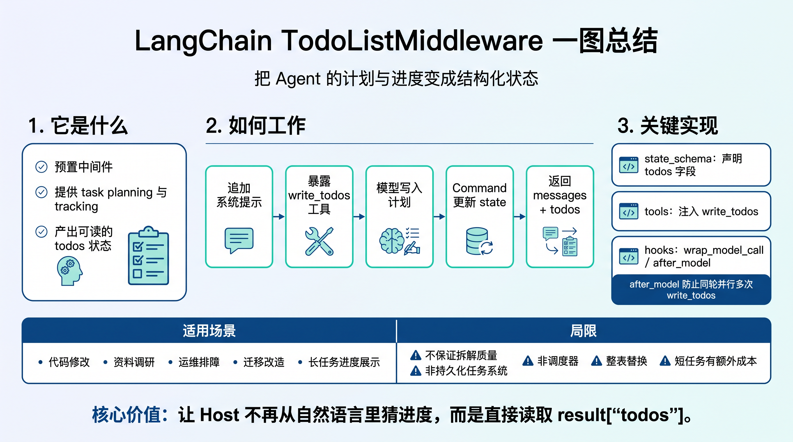
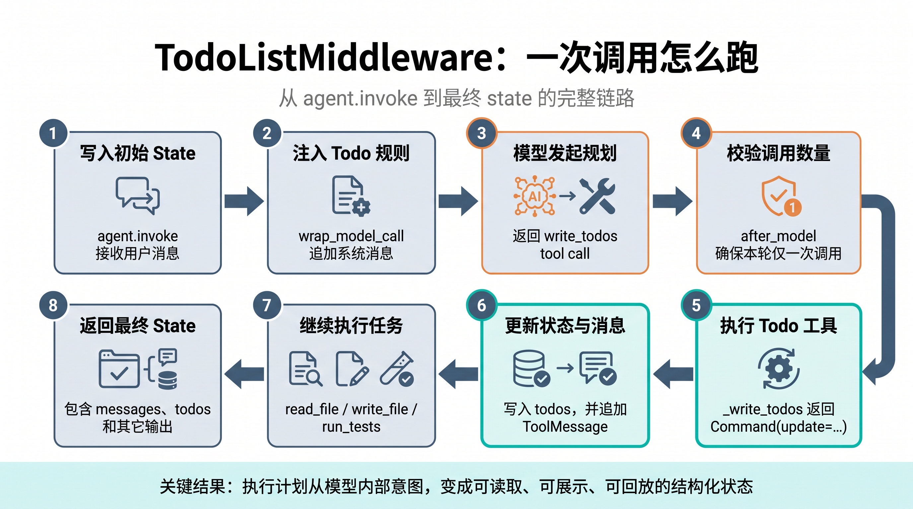

# LangChain TodoListMiddleware详解

# 一图总结



# TodoListMiddleware是什么

`TodoListMiddleware` 是 LangChain Agent 的预置中间件，让模型能够创建并维护结构化待办列表。官方把它描述为为 Agent 提供 task planning 和 tracking 能力的 middleware。

# 从一个例子讲起

概念比较抽象，直接看下面的最小示例，含义：给 Agent 配置 2 个业务工具，再挂载 TodoListMiddleware，让 Agent 写个 demo。

```python
from pathlib import Path
import subprocess
import sys
from langchain.agents import create_agent
from langchain.agents.middleware import TodoListMiddleware
from langchain.chat_models import init_chat_model
from langchain_core.tools import tool
from rich import print as rich_print

@tool
def write_file(path: str, content: str) -> str:
    *"""写入 UTF-8 文本文件。"""*
*    *Path(path).write_text(content, encoding="utf-8")
    return f"wrote {path}"

@tool
def run_tests(path: str) -> str:
    *"""运行指定测试文件。"""*
*    *completed = subprocess.run(
        [sys.executable, "-m", "pytest", path],
        cwd=project_root,
        capture_output=True,
        text=True,
        check=False,
    )
    return completed.stdout + completed.stderr

agent = create_agent(
    model="openai:gpt-5.5",
    tools=[write_file, run_tests],
    middleware=[TodoListMiddleware()],
)

result = agent.invoke({
    "messages": [{
        "role": "user",
        "content": "请先使用 todo list 规划，在 demo.py 中写 hello_world 函数并运行测试",
    }]
})

rich_print("返回结果：",result)
```

省略非讲解内容后，输出如下：

```Python
返回结果：
{
    'messages': [
        HumanMessage(
            content='请先使用 todo list 规划，在 demo.py 中写 hello_world 函数并运行测试',
        ),
        AIMessage(
            tool_calls=[
                {
                    'name': '**write_todos**',
                    'args': {
                        'todos': [
                            {
                                'content': '规划并创建 demo.py，定义 hello_world
函数',
                                'status': 'in_progress'
                            },
                            {
                                'content': '运行测试验证 demo.py',
                                'status': 'pending'
                            },
                            {
                                'content': '根据测试结果给出总结',
                                'status': 'pending'
                            }
                        ]
                    },
                }
            ],
        ),
        ToolMessage(
            content="Updated todo list to [{'content': '规划并创建 demo.py，定义
hello_world 函数', 'status': 'in_progress'}, {'content': '运行测试验证 demo.py',
'status': 'pending'}, {'content': '根据测试结果给出总结', 'status': 
'pending'}]",
            name='write_todos',
        ),
        AIMessage(
            tool_calls=[
                {
                    'name': 'write_file',
                    'args': {
                        'path': 'demo.py',
                        'content': 'def hello_world():\n    return "Hello, 
World!"\n'
                    },
                    'type': 'tool_call'
                }
            ],
        ),
        ToolMessage(
            content='wrote demo.py',
            name='write_file',
        ),
        AIMessage(
            tool_calls=[
                {
                    'name': 'write_todos',
                    'args': {
                        'todos': [
                            {
                                'content': '规划并创建 demo.py，定义 hello_world函数',
                                'status': 'completed'
                            },
                            {
                                'content': '运行测试验证 demo.py',
                                'status': 'in_progress'
                            },
                            {
                                'content': '根据测试结果给出总结',
                                'status': 'pending'
                            }
                        ]
                    },
                    'type': 'tool_call'
                }
            ],
        ),
        ToolMessage(
            content="Updated todo list to [{'content': '规划并创建 demo.py，定义hello_world 函数', 'status': 'completed'}, {'content': '运行测试验证 demo.py', 'status': 'in_progress'}, {'content': '根据测试结果给出总结', 'status': 'pending'}]",
            name='write_todos',
        ),
        AIMessage(
            tool_calls=[
                {
                    'name': 'run_tests',
                    'args': {'path': 'demo.py'},
                    'type': 'tool_call'
                }
            ],
        ),
        ToolMessage(
            content='============================= test session starts ==============================\nplatform darwin -- Python 3.13.16, pytest-9.1.1,pluggy-1.6.0\nrootdir: techrooting/demo\nconfigfile: pyproject.toml\nplugins: platformdirs-4.13.0, langsmith-0.14.7, anyio-4.15.1\ncollected 0 items\n\n============================ no tests ran in 0.00s =============================\n',
            name='run_tests',
        ),
        AIMessage(
            tool_calls=[
                {
                    'name': 'write_todos',
                    'args': {
                        'todos': [
                            {
                                'content': '规划并创建 demo.py，定义 hello_world函数',
                                'status': 'completed'
                            },
                            {
                                'content': '运行测试验证 demo.py',
                                'status': 'completed'
                            },
                            {
                                'content': '根据测试结果给出总结',
                                'status': 'in_progress'
                            }
                        ]
                    },
                    'type': 'tool_call'
                }
            ],
        ),
        ToolMessage(
            content="Updated todo list to [{'content': '规划并创建 demo.py，定义hello_world 函数', 'status': 'completed'}, {'content': '运行测试验证 demo.py', 'status': 'completed'}, {'content': '根据测试结果给出总结', 'status': 'in_progress'}]",
            name='write_todos',
        ),
        AIMessage(
            tool_calls=[
                {
                    'name': 'write_todos',
                    'args': {
                        'todos': [
                            {
                                'content': '规划并创建 demo.py，定义 hello_world函数',
                                'status': 'completed'
                            },
                            {
                                'content': '运行测试验证 demo.py',
                                'status': 'completed'
                            },
                            {
                                'content': '根据测试结果给出总结',
                                'status': 'completed'
                            }
                        ]
                    },
                    'id': 'call_zU5yUCYMqMfYKmNOuZvPDjlH',
                    'type': 'tool_call'
                }
            ],
        ),
        ToolMessage(
            content="Updated todo list to [{'content': '规划并创建 demo.py，定义
hello_world 函数', 'status': 'completed'}, {'content': '运行测试验证 demo.py', 
'status': 'completed'}, {'content': '根据测试结果给出总结', 'status': 
'completed'}]",
            name='write_todos',
        ),
        AIMessage(
            content='已在 `demo.py` 中写入：\n\n```python\ndef hello_world():\n 
return "Hello, World!"\n```\n\n并已运行测试：\n\n```text\ncollected 0 items\nno 
tests ran in 
0.00s\n```\n\n说明：测试命令执行成功，但当前没有收集到任何测试用例。',
            tool_calls=[],
        )
    ],
    'todos': [
        {
            'content': '规划并创建 demo.py，定义 hello_world 函数',
            'status': 'completed'
        },
        {'content': '运行测试验证 demo.py', 'status': 'completed'},
        {'content': '根据测试结果给出总结', 'status': 'completed'}
    ]
}
```

返回结果包含两部分：

1. messages是运行过程和过程结果，总结如下：


2. todos是中间件产生的规划，可以直接返回给前端，到这里你应该有些疑惑：todos是怎么产生的？为什么名字是todos，不是别的？里面的content和status是什么怎么定义的？怎么写到返回结果的？write\_todos工具又是什么？别急，下面就一一讲解！

如果多尝试几种例子，会发现：如果没有“请先使用 todo list 规划”这段prompt，复杂任务也可能产生 todos；简单任务通常不会。为什么？

# 原理解析

理解这套机制，最稳妥的顺序是：先看 `TodoListMiddleware` 的参数和方法，再看 `create_agent` 如何使用，最后沿一次 `invoke` 追踪状态如何写入和返回。

## `TodoListMiddleware`参数和方法

`TodoListMiddleware`类包含：1个类属性：state\_schema和5个方法：\_\_init\_\_，wrap\_model\_call，awrap\_model\_call，after\_model，aafter\_model

类属性state\_schema定义如下：

```Python
class Todo(TypedDict):
    content: str
    status: Literal["pending", "in_progress", "completed"]

class PlanningState(AgentState[ResponseT]):
    todos: Annotated[NotRequired[list[Todo]], OmitFromInput]

state_schema = PlanningState
```

Todo类包含了content和status，`content` 描述任务，`status` 表示进度（有三种取值"pending", "in\_progress", "completed"），看到这应该结果里的content和status是怎么定义的了吧！

注：这里的todos 没配置合并规则，默认是覆盖


\_\_init\_\_方法如下：

```Python
def __init__(
    self,
    *,
    system_prompt: str = WRITE_TODOS_SYSTEM_PROMPT,# 默认system prompt
    tool_description: str = WRITE_TODOS_TOOL_DESCRIPTION,# 默认tool description
) -> None:
    super().__init__()
    self.system_prompt = system_prompt
    self.tool_description = tool_description # 没有使用位置

    self.tools = [
        StructuredTool.from_function(
            name="write_todos",
            description=tool_description,
            func=_write_todos,
            coroutine=_awrite_todos,
            args_schema=WriteTodosInput,
            infer_schema=False,
        )
    ]
# _write_todos方法返回Command
# todos 来自上面的PlanningState，没配置合并规则，所以默认是覆盖；`
# messages 来源于AgentState，配了add_messages 合并器，所以是追加/合并。
def _write_todos(
    runtime: ToolRuntime[ContextT, PlanningState[ResponseT]], todos: list[Todo]
) -> Command[Any]:
    return Command(
        update={
            "todos": todos,
            "messages": [
                ToolMessage(f"Updated todo list to {todos}", tool_call_id=runtime.tool_call_id)
            ],
        }
    )
# 在AgentState 里，messages是这样定义的
class AgentState(TypedDict, Generic[ResponseT]):
    messages: Required[Annotated[list[AnyMessage], add_messages]]
```

一共三步：

1. 父类初始化

2. 保存实例属性system\_prompt和tool\_description（tool\_description实际没有使用位置）

3. 用入参的tool\_description动态构造一个名为 `write_todos` 的 `StructuredTool`并赋值给实例属性tools，即message里的write\_todos tool，该tool会在运行时覆盖写todos属性，和在messages里添加ToolMessage


`入参system_prompt`和`tool_description`两个参数作用如下：

|参数|影响位置|实际作用|
|---|---|---|
|`system_prompt`|每次模型调用前的系统消息|告诉模型何时使用 todo、如何推进状态、何时不要使用|
|`tool_description`|write\_todos 的工具描述|影响模型对工具用途、输入要求和更新规则的理解|

两者解决的问题不同：`system_prompt` 约束整体行为，`tool_description` 解释某次工具调用。定制时不要让两者的规则互相冲突。


注：短任务不一定会产生 todo。

默认的`system_prompt`要求复杂目标优先使用`write_todos`工具，是否产生 todos 取决于模型对任务复杂度的判断，其次，默认`system_prompt`明确要求：少于 3 个简单步骤、一次性工具调用或纯问答应直接执行，避免额外 token 和交互成本。

如果确定要产生todos，有以下两个方法：

1. 可以像例子那样在prompt里明确用

2. 初始化时传入自己的`system_prompt`（不建议，因为默认的`system_prompt`，写的很不错，详情见附录）


wrap\_model\_call方法作用是在调用模型前，修改系统提示词，有就添加，没有就新建，即通过提示词，让模型产生`write_todos`工具的function call。awrap\_model\_call方法与wrap\_model\_call方法类似，唯一的区别是最后的return是await handler

```Python
def wrap_model_call(
        self,
        request: ModelRequest[ContextT],
        handler: Callable[[ModelRequest[ContextT]], ModelResponse[ResponseT]],
    ) -> ModelResponse[ResponseT] | AIMessage:
        if request.system_message is not None:
            new_system_content = [
                *request.system_message.content_blocks,
                {"type": "text", "text": f"\n\n{self.system_prompt}"},
            ]
        else:
            new_system_content = [{"type": "text", "text": self.system_prompt}]
        new_system_message = SystemMessage(
            content=cast("list[str | dict[str, str]]", new_system_content)
        )
        return handler(request.override(system_message=new_system_message))

```


after\_model方法在模型返回后被调用，核心逻辑是如果write\_todos工具调用次数\>1，返回错误 ToolMessage。aafter\_model方法直接返回after\_model方法的引用

`after_model` 的冲突保护很重要。因为每次调用都会替换完整列表，如果同一模型轮次并行写两份列表，就无法定义谁覆盖谁。源码会给这些调用返回错误 ToolMessage，要求模型下一轮只调用一次。

```Python
@override
def after_model(
    self, state: PlanningState[ResponseT], runtime: Runtime[ContextT]
) -> dict[str, Any] | None:
    messages = state["messages"]
    if not messages:
        return None

    last_ai_msg = next((msg for msg in reversed(messages) if isinstance(msg, AIMessage)), None)
    if not last_ai_msg or not last_ai_msg.tool_calls:
        return None

    # 如果write_todos工具调用次数>1，返回错误 ToolMessage
    write_todos_calls = [tc for tc in last_ai_msg.tool_calls if tc["name"] == "write_todos"]

    if len(write_todos_calls) > 1:
        error_messages = [
            ToolMessage(
                content=(
                    "Error: The `write_todos` tool should never be called multiple times "
                    "in parallel. Please call it only once per model invocation to update "
                    "the todo list."
                ),
                tool_call_id=tc["id"],
                status="error",
            )
            for tc in write_todos_calls
        ]
        return {"messages": error_messages}

    return None
```

## 总结如下：

|成员|执行时机|作用|
|---|---|---|
|`state_schema`|create\_agent 建图时|声明 PlanningState，让 state 支持 todos 字段|
|`tools`|create\_agent 收集工具时|暴露 write\_todos 给 Agent|
|`wrap_model_call`|同步模型调用前|把 todo 使用规则追加到 system message，再调用下层 handler|
|`awrap_model_call`|异步模型调用前|同步方法的异步版本|
|`after_model`|模型返回后|检测同一轮是否并行调用多个 write\_todos|
|`aafter_model`|异步模型返回后|异步入口，复用 after\_model 的校验|
|`_write_todos`|工具节点执行时|返回 Command，更新 todos 并追加 ToolMessage|

## create\_agent 串联了什么

`create_agent(..., middleware=[TodoListMiddleware()])` 并不是简单保存一个对象。它会读取中间件的约定属性（tools，state\_schema）和 hook（`wrap_model_call`和`after_model`），把 Todo 能力编进 LangGraph

tools编排逻辑分三步
1\. 遍历 middleware，从每个实例的 tools 收集附加工具。

2\. 把 middleware 工具与 tools=\[\.\.\.\] 中的业务工具合并。合并后的tools=\[write\_todos,write\_file, run\_tests\]

3\. 用合并后的工具创建 ToolNode，因此agent可以调用 write\_todos

```Python
# 1. 遍历 middleware，从每个实例的 tools 收集附加工具。factory.py:L1089
middleware_tools = [t for m in middleware for t in getattr(m, "tools", [])] 
# 2. 把 middleware 工具与 tools=[...] 中的业务工具合并。 factory.py:L1135-L1136
available_tools = middleware_tools + regular_tools 
# 3. 用合并后的工具创建 ToolNode，因此agent可以调用 write_todos。factory.py:L1140-L1145
tool_node = ( 
    ToolNode(
        tools=available_tools,
        wrap_tool_call=wrap_tool_call_wrapper,
        awrap_tool_call=awrap_tool_call_wrapper,
    )
    if available_tools or wrap_tool_call_wrapper or awrap_tool_call_wrapper
    else None
)
```

todos属性创建流程

1\. 收集每个 middleware 的 state\_schema，与基础 AgentState 合并

2\. 用合并后的 schema 创建 StateGraph，最终 state 因而包含 todos

```Python
# 1. 收集每个 middleware 的 state_schema，与基础 AgentState 合并 factory.py:L1232
state_schemas: list[type] = [*(m.state_schema for m in middleware), base_state] 
# _resolve_schemas 会读取这些 TypedDict 的 type hints 并合并字段 factory.py:L1234
resolved_state_schema, input_schema, output_schema = _resolve_schemas(state_schemas) 
# _resolve_schemas方法主要内容 factory.py:L477-L485
for schema in schemas: 
    schema_hints[schema] = _get_schema_type_hints(schema)

return (
    _resolve_schema(schema_hints, "StateSchema", None),
    _resolve_schema(schema_hints, "InputSchema", "input"),
    _resolve_schema(schema_hints, "OutputSchema", "output"),
)
# 2. 用合并后的 schema 创建 StateGraph，最终 state 因而包含 todos。
graph: StateGraph[
    AgentState[ResponseT], ContextT, InputAgentState, OutputAgentState[ResponseT]
] = StateGraph(
    state_schema=resolved_state_schema,
    input_schema=input_schema,
    output_schema=output_schema,
    context_schema=context_schema,
)
```

`wrap_model_call`（模型调用前）、`after_model`（模型返回后）等 hook，通过下面的方法收集，并插入模型节点生命周期。

```Python
middleware_w_wrap_model_call = [
    m
    for m in middleware
    if m.__class__.wrap_model_call is not AgentMiddleware.wrap_model_call
    or m.__class__.awrap_model_call is not AgentMiddleware.awrap_model_call
]
middleware_w_after_model = [
    m
    for m in middleware
    if m.__class__.after_model is not AgentMiddleware.after_model
    or m.__class__.aafter_model is not AgentMiddleware.aafter_model
]
```

## 一次调用流程总结如下



1. `agent.invoke` 把用户消息写入初始 state。

2. 模型节点运行前，`wrap_model_call` 把 Todo 规则追加到系统消息。

3. 模型判断任务需要规划，返回一次 `write_todos` tool call。

4. `after_model` 检查本轮 write\_todos 调用数量；只有一个时正常继续。

5. ToolNode 执行 `_write_todos`，返回 `Command(update=...)`。

6. LangGraph 把完整 todos 写入 state，同时把“Updated todo list\.\.\.”作为 ToolMessage 加入 messages。

7. 模型继续调用业务工具（如 write\_file、run\_tests），并在状态变化时再次写入完整列表。

8. 调用结束时返回最终 state，里面同时包含 messages、todos 及其它输出字段。


## 

---

# TodoListMiddleware做什么用

**核心价值是把模型脑中的执行计划变成可读取、可展示、可回放的结构化状态。**没有这个中间件时，Host 通常只能从自然语言消息里猜进度；启用后可以直接读取 `result["todos"]`。

|能力|没有中间件|启用后|
|---|---|---|
|任务拆解|计划藏在上下文或回复文本里|模型输出结构化 todo 数组|
|进度更新|依赖自然语言说明|通过 write\_todos 更新运行时 state|
|外部展示|需要解析消息文本|前端直接渲染 content 和 status|
|调试回放|难判断模型在哪一步偏离|可沿 todo 状态和消息序列复盘|

**边界**：TodoListMiddleware 提供规划的“载体”和“约束”，真正的任务拆解仍由模型完成。

---

# TodoListMiddleware适用场景和局限

## 适用场景

- 代码修改：读代码、实现、测试、修复、复验。

- 资料调研：拆问题、检索、交叉验证、汇总结论。

- 运维排障：收集信号、定位假设、执行验证、恢复确认。

- 迁移改造：盘点依赖、分批修改、回归测试、清理旧逻辑。

- 用户可见的长任务：需要持续展示当前步骤和完成度。

## 局限

- **不保证拆解质量**：模型仍可能漏步骤、粒度失衡或错误完成。

- **不是持久化任务系统**：跨会话恢复需要 checkpointer、数据库或业务状态层。

- **不是调度器**：没有依赖图、优先级队列、超时、重试和资源隔离。

- **整表替换**：更新必须传完整列表，超长列表会增加 token 和覆盖风险。

- **短任务有额外成本**：多一轮工具调用、更多上下文和更多状态更新。

---

# TodoListMiddleware工程建议

1. **把它定位为可观测性能力**。先问产品是否需要显示和回放过程，再决定是否启用。

2. **为 todo 定义完成标准**。例如“运行测试”不等于“测试通过”，失败时不要标 completed。

3. **控制列表长度**。通常保留阶段级任务；细节放在工具参数、日志或子任务中。

4. **更新时总是传完整列表**。不要只传新增项或本次改变的单项。

5. **展示层读取 todos**。messages 用于对话和调试，不作为进度真相源。

6. **为复杂度设置门槛**。小于 3 个简单步骤、纯问答、一次性工具调用默认跳过。

7. **补齐持久化与恢复**。长时间任务需要 checkpointer；跨系统任务还要有业务任务 ID 和幂等设计。

8. **测试异常路径**。至少覆盖工具失败、模型漏更新、并行 write\_todos、调用中断和恢复续跑。

---

# TodoListMiddleware使用最终判断顺序

是否使用 TodoListMiddleware，可以按下面的顺序判断。前一项不满足，就不必继续往后评估。

1. **任务是否需要多步执行？** 如果只是短问答或一次工具调用，不启用。

2. **步骤是否会随中间结果变化？** 如果计划需要动态修订，启用价值明显。

3. **用户或 Host 是否需要看到进度？** 需要展示、回放或审计时优先启用。

4. **业务工具能否对应可验证结果？** 工具粒度不合适时，先调整工具设计。

5. **是否接受额外 token 和工具轮次？** 对极低延迟链路应谨慎启用。

6. **是否需要跨会话持久化？** 需要时同步配置 checkpointer 或外部状态存储。

**最终建议**：面向用户的编码、研究、运维等长链路 Agent，可以默认启用；短任务、高频低延迟调用、无需展示过程的内部链路，按复杂度动态关闭。它提升的是规划过程的可见性和可控性，不是模型的规划上限。

# 附录

## WRITE\_TODOS\_SYSTEM\_PROMPT 定义

```Python
## `write_todos`

You have access to the `write_todos` tool to help you manage and plan complex objectives.
Use this tool for complex objectives to ensure that you are tracking each necessary step.
This tool is very helpful for planning complex objectives, and for breaking down these larger complex objectives into smaller steps.

It is critical that you mark todos as completed as soon as you are done with a step. Do not batch up multiple steps before marking them as completed.
For simple objectives that only require a few steps, it is better to just complete the objective directly and NOT use this tool.
Writing todos takes time and tokens, use it when it is helpful for managing complex many-step problems! But not for simple few-step requests.

## Important To-Do List Usage Notes to Remember

- The `write_todos` tool should never be called multiple times in parallel.
- Don't be afraid to revise the To-Do list as you go. New information may reveal new tasks that need to be done, or old tasks that are irrelevant.

## Finishing a task

When you finish all work, write your final answer in the message AFTER your last `write_todos` call — not in the same turn as that call. Start the final message with the substantive content the user asked for — the data, computation, summary, or analysis. The user wants the result, not confirmation that the work is done.

翻译如下：
## write_todos
你可以使用 write_todos 工具来协助管理和规划复杂目标。对于复杂目标，应使用此工具，以确保每个必要步骤都得到跟踪。它特别适合规划复杂任务，并将规模较大的复杂目标拆分成更小的步骤。
完成某个步骤后，必须立即将对应的待办事项标记为已完成。不要等多个步骤都完成后再集中标记。
对于只需少量步骤即可完成的简单目标，最好直接完成，不要使用此工具。编写待办事项会消耗时间和 token，因此，应在它有助于管理复杂、多步骤问题时使用，而不应用于只有少数步骤的简单请求。
## 需要牢记的重要待办事项使用说明
- 绝不能并行多次调用 write_todos 工具。
- 不必担心在执行过程中修改待办清单。新信息可能会带来需要完成的新任务，也可能让原有任务变得不再相关。
## 完成任务
完成所有工作后，应在最后一次调用 write_todos 之后的下一条消息中撰写最终答复，不要在调用该工具的同一轮消息中给出最终答复。
最终消息应直接以用户要求的实质性内容开头，例如数据、计算结果、摘要或分析。用户想看到的是结果，而不是 “工作已经完成” 的确认信息。
```

## WRITE\_TODOS\_TOOL\_DESCRIPTION 定义

```Markdown

Use this tool to create and manage a structured task list for your current work session. This helps you track progress and organize complex tasks.

Only use this tool if you think it will be helpful in staying organized. If the user's request is trivial and takes less than 3 steps, it is better to NOT use this tool and just do the task directly.

## When to Use This Tool

Use this tool in these scenarios:

1. Complex multi-step tasks - When a task requires 3 or more distinct steps or actions
2. Non-trivial and complex tasks - Tasks that require careful planning or multiple operations
3. User explicitly requests todo list - When the user directly asks you to use the todo list
4. User provides multiple tasks - When users provide a list of things to be done (numbered or comma-separated)
5. The plan may need future revisions or updates based on results from the first few steps

## How to Use This Tool

1. When you start working on a task - Mark it as in_progress BEFORE beginning work.
2. After completing a task - Mark it as completed and add any new follow-up tasks discovered during implementation.
3. You can also update future tasks, such as deleting them if they are no longer necessary, or adding new tasks that are necessary. Don't change previously completed tasks.
4. You can make several updates to the todo list at once. For example, when you complete a task, you can mark the next task you need to start as in_progress.

## When NOT to Use This Tool

It is important to skip using this tool when:
1. There is only a single, straightforward task
2. The task is trivial and tracking it provides no benefit
3. The task can be completed in less than 3 trivial steps
4. The task is purely conversational or informational

## Task States and Management

1. **Task States**: Use these states to track progress:
    - pending: Task not yet started
    - in_progress: Currently working on (you can have multiple tasks in_progress at a time if they are not related to each other and can be run in parallel)
    - completed: Task finished successfully

2. **Task Management**:
    - Update task status in real-time as you work
    - Mark tasks complete IMMEDIATELY after finishing (don't batch completions)
    - Complete current tasks before starting new ones
    - Remove tasks that are no longer relevant from the list entirely
    - IMPORTANT: When you write this todo list, you should mark your first task (or tasks) as in_progress immediately!.
    - IMPORTANT: Unless all tasks are completed, you should always have at least one task in_progress.

3. **Task Completion Requirements**:
    - ONLY mark a task as completed when you have FULLY accomplished it
    - If you encounter errors, blockers, or cannot finish, keep the task as in_progress
    - When blocked, create a new task describing what needs to be resolved
    - Never mark a task as completed if:
        - There are unresolved issues or errors
        - Work is partial or incomplete
        - You encountered blockers that prevent completion
        - You couldn't find necessary resources or dependencies
        - Quality standards haven't been met

4. **Task Breakdown**:
    - Create specific, actionable items
    - Break complex tasks into smaller, manageable steps
    - Use clear, descriptive task names

Being proactive with task management ensures you complete all requirements successfully
Remember: If you only need to make a few tool calls to complete a task, and it is clear what you need to do, it is better to just do the task directly and NOT call this tool at all.

## When You Finish

`write_todos` tracks your work; it does not deliver the answer. Whatever the user asked for — computations, summaries, comparisons, data — must appear as text content in a message after your final `write_todos` call. Marking the last todo complete is not itself an answer to the user.

翻译：
使用此工具为当前工作会话创建和管理结构化的任务清单。这有助于你跟踪进度并组织复杂任务。
仅当你认为此工具有助于保持工作有序时才使用它。如果用户的请求很简单，并且不到 3 个步骤就能完成，那么最好不要使用此工具，直接完成任务即可。
## 何时使用此工具
在以下场景中使用此工具：
1. 复杂的多步骤任务：任务需要 3 个或更多相互独立的步骤或操作。
2. 并非简单且较为复杂的任务：任务需要周密规划或多项操作。
3. 用户明确要求待办清单：用户直接要求你使用待办清单。
4. 用户提供了多项任务：用户列出了多个需要完成的事项，例如使用编号或逗号分隔。
5. 计划可能需要调整：根据前几个步骤的结果，后续计划可能需要修改或更新。
## 如何使用此工具
1. 开始处理任务时：在开始工作之前，将该任务标记为 in_progress。
2. 完成任务后：将其标记为 completed，并添加执行过程中发现的任何后续任务。
3. 你也可以更新尚未执行的任务。例如，当某项任务不再需要时将其删除，或添加新发现的必要任务。不要修改此前已经完成的任务。
4. 可以一次更新待办清单中的多项内容。例如，完成一项任务时，可以同时将下一项需要开始的任务标记为 in_progress。
## 何时不应使用此工具
在以下情况下，应跳过此工具：
1. 只有一项简单、直接的任务。
2. 任务很琐碎，跟踪进度没有任何帮助。
3. 不到 3 个简单步骤即可完成任务。
4. 任务仅涉及对话或提供信息。
## 任务状态与管理
1. 任务状态
使用以下状态跟踪进度：
    - pending：任务尚未开始。
    - in_progress：当前正在处理。若多项任务彼此无关且可以并行执行，可以同时将它们标记为 in_progress。
    - completed：任务已成功完成。
2. 任务管理
    - 在工作过程中实时更新任务状态。
    - 完成任务后，立即将其标记为已完成，不要集中批量更新。
    - 完成当前任务后再开始新任务。
    - 将不再相关的任务从清单中彻底删除。
    - 重要：创建待办清单时，应立即将第一项任务（或多项任务）标记为 in_progress。
    - 重要：除非所有任务都已完成，否则应始终至少有一项任务处于 in_progress 状态。
3. 任务完成要求
    - 只有在任务已经完全完成时，才能将其标记为 completed。
    - 如果遇到错误、阻碍或无法完成任务，应让该任务保持 in_progress 状态。
    - 遇到阻碍时，创建一项新任务，说明需要解决的问题。
    - 在以下情况下，绝不能将任务标记为已完成： 
        - 仍有尚未解决的问题或错误；
        - 工作只完成了一部分或尚不完整；
        - 遇到了导致任务无法完成的阻碍；
        - 无法找到必要的资源或依赖项；
        - 尚未达到质量标准。
4. 任务拆分
    - 创建具体且可执行的任务事项。
    - 将复杂任务拆分成更小、更易于管理的步骤。
    - 使用清晰、具有描述性的任务名称。
主动进行任务管理，可以确保你顺利完成所有要求。
请记住：如果只需调用几次工具就能完成任务，并且需要做什么十分明确，那么最好直接完成任务，完全不要调用此工具。
## 完成任务时
write_todos 用于跟踪工作，而不是交付答案。无论用户要求的是计算结果、摘要、对比还是数据，都必须在最后一次调用 write_todos 之后的消息中以文本形式给出。
将最后一项待办事项标记为已完成，本身并不等同于向用户作出答复。
```


