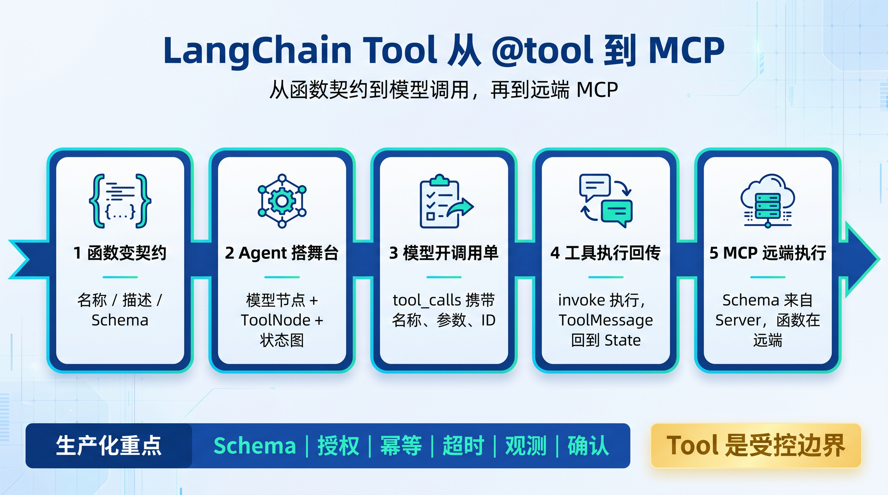
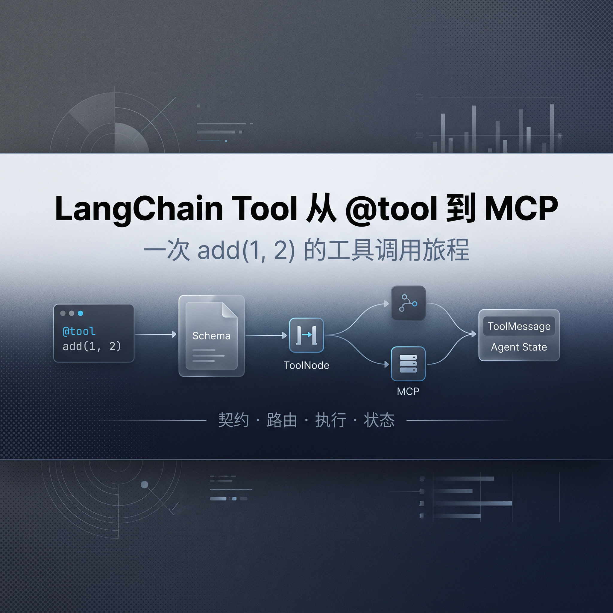

# LangChain Tool 从 @tool 到 MCP

# 一图总结



**阅读地图**

- **主线**：跟随一次 `add(a=1, b=2)`，看它如何从函数变成 Schema、从模型意图变成真实调用，再回到 Agent State。

- **MCP 分岔**：MCP Tool 进入 Agent 后仍表现为 `BaseTool`，但 Schema 来自 Server，真实函数在远端执行。

- **工程判断**：Tool 的稳定性首先取决于契约、权限与副作用治理，而不是工具数量。

---

# 先看一个例子

用户只问了一句：“1 加 2 等于多少？”模型却没有直接回答。它生成了一张结构化调用单：工具名是 `add`，参数是 `{"a": 1, "b": 2}`，调用编号是 `call_xxx`。这张调用单接下来会穿过 LangChain、LangGraph 和 Python 函数边界，最后带着结果 3 回到消息历史。

理解这趟旅程，Tool 的注册、执行、状态合并，以及 MCP Tool 与普通 Tool 的区别，就会落到同一张图上

```Python
import os
from langchain.agents import create_agent
from langchain_core.tools import tool
from rich import print as rich_print

@tool
def add(a: int, b: int) -> int:
    """计算两个整数之和。"""
    return a + b

agent = create_agent(
    model="openai:gpt-5.5",
    tools=[add],
)
result = agent.invoke({
    "messages": [{
        "role": "user",
        "content": "请使用 add 工具计算 1+2=?",
    }]
})

rich_print("返回结果：",result)
```

```Python
返回结果：
{
    'messages': [
        HumanMessage(
            content='请使用 add 工具计算 1+2=?',
            id='3f00b8d7-b08d-446d-8828-efcfd5557bb6'
        ),
        AIMessage(
            tool_calls=[
                {
                    'name': 'add',
                    'args': {'a': 1, 'b': 2},
                    **'id': 'call_AyJoULXai4Cym5nfZjj0EUCO',**
                    'type': 'tool_call'
                }
            ],
        ),
        ToolMessage(
            content='3',
            name='add',
            **tool_call_id='call_AyJoULXai4Cym5nfZjj0EUCO'**
        ),
        AIMessage(
            content='1 + 2 = 3',
        )
    ]
}

```

## 一、出发前：函数先变成契约

**模型看不到 Python 函数对象，它只看得到工具名称、描述和 JSON Schema。**

因此 `@tool` 的第一项工作不是“执行函数”，而是把函数整理成模型和运行时都能理解的 Tool 对象。

```python
from langchain_core.tools import tool

@tool
def add(a: int, b: int) -> int:
    """计算两个整数之和。"""
    return a + b
```

```Python
def tool(
    name_or_callable: str | Callable[..., Any] | None = None,
    runnable: Runnable[Any, Any] | None = None, # 暂时忽略，这个参数是在已经有了chain = prompt | model | parser，讲这个chain当作tool使用时用的：my_tool = tool("my_tool", chain)
    *args: Any,
    **description: str | None = None,**
    return_direct: bool = False,
    **args_schema: ArgsSchema | None = None,**
**    infer_schema: bool = True,**
    response_format: Literal["content", "content_and_artifact"] = "content",
    parse_docstring: bool = False,
    error_on_invalid_docstring: bool = True,
    extras: dict[str, Any] | None = None,
) -> BaseTool | Callable[[Callable[..., Any] | Runnable[Any, Any]], BaseTool]:
    def _create_tool_factory(
        **tool_name: str,**
    ) -> Callable[[Callable[..., Any] | Runnable[Any, Any]], BaseTool]:
        def _tool_factory(
                **dec_func**: Callable[..., Any] | Runnable[Any, Any],
            ) -> BaseTool:
            **tool_description = description**
            if isinstance(dec_func, Runnable):
                def invoke_wrapper(
                    callbacks: Callbacks | None = None, **kwargs: Any
                ) -> Any:
                    return runnable.invoke(kwargs, {"callbacks": callbacks})
                **coroutine = ainvoke_wrapper**
**                func = invoke_wrapper**
            elif inspect.iscoroutinefunction(dec_func): # 异步函数，mcp会走这个
                **coroutine = dec_func**
**                func = None**
            else:
                **coroutine = None**
**                func = dec_func**
                schema = args_schema
            if infer_schema or args_schema is not None:
                **return StructuredTool.from_function**(
                    func,
                    coroutine,
                    name=tool_name,
                    description=tool_description,
                    return_direct=return_direct,
                    args_schema=schema,
                    infer_schema=infer_schema,
                    response_format=response_format,
                    parse_docstring=parse_docstring,
                    error_on_invalid_docstring=error_on_invalid_docstring,
                    extras=extras,
                )
            return _tool_factory
    
    if name_or_callable is not None:
        # 能被当成函数处理 and 可以从它身上拿到工具名，比如`"add"`
        if callable(name_or_callable) and hasattr(name_or_callable, "__name__"):
            return _create_tool_factory(**name_or_callable.__name__**)(name_or_callable)
```

`@tool` 会进入 `StructuredTool.from_function(...)`。这个方法会将**函数名成为工具名**，docstring 成为描述，类型注解被转换为 Pydantic 模型，再导出为 JSON Schema。装饰后的 `add` 已经不是裸函数，而是一个**持有原始函数**、**参数 Schema **与**执行方法**的 `StructuredTool`。

```python
class StructuredTool(BaseTool): # BaseTool这个父类还有一些参数
    description: str = ""
    args_schema: Annotated[ArgsSchema, SkipValidation(), _JsonSchemaFallback] = Field(
        ..., description="The tool schema."
    )
    func: Annotated[Callable[..., Any] | None, _JsonCallableFallback] = None
    coroutine: Annotated[
        Callable[..., Awaitable[Any]] | None, _JsonCallableFallback
    ] = None

```

**契约先于实现**：名称回答“调用谁”，描述回答“何时调用”，Schema 回答“参数怎么填”，函数实现才回答“实际做什么”。

---

## 二、搭好舞台：create\_agent 组装闭环

`create_agent` 不是一次模型调用的包装器，而是一个图工厂。它把模型节点、工具节点、条件边、中间件、checkpointer、store 和 cache 组装为 `CompiledStateGraph`。

工具进入工厂后先被分成两组：普通客户端工具会进入 `ToolNode`，provider 原生工具通常以 dict 形态透传给模型供应商。

```python
def create_agent(
    model: str | BaseChatModel,
    tools: Sequence[BaseTool | Callable[..., Any] | dict[str, Any]] | None = None,
    *,
    # 其他字段省略
) -> CompiledStateGraph[
    AgentState[ResponseT], ContextT, InputAgentState, OutputAgentState[ResponseT]
]:
    tools = tools or []
    built_in_tools = [t for t in tools if isinstance(t, dict)]
    regular_tools = [t for t in tools if not isinstance(t, dict)]
    
    available_tools = [*regular_tools, *middleware_tools]
    tool_node = **ToolNode**(available_tools) if available_tools else None
    
    default_tools = [*tool_node.tools_by_name.values(), *built_in_tools]
```

`ToolNode` 会把 callable 继续转换成 `BaseTool`，并建立名称索引。真实执行时不会临时从全局作用域反射查找函数；函数对象早已被 Tool 持有。

```python
for tool in tools:
    tool_ = tool if isinstance(tool, BaseTool) else create_tool(tool)
    self._tools_by_name[tool_.name] = tool_
    self._injected_args[tool_.name] = _get_all_injected_args(tool_)
```

由此得到一张稳定的映射：`{"add": add_tool}`。同名工具会落到同一个字典键上，工程侧应在启动时检测重名，避免后注册项静默覆盖前项。

---

## 三、模型开单：AIMessage 产生 tool\_calls

模型绑定工具后，拿到的是契约而不是函数。面对“1 加 2”，它可能生成下面这条 `AIMessage`：

```python
AIMessage(
    content="",
    tool_calls=[{
        "name": "add",
        "args": {"a": 1, "b": 2},
        "id": "call_xxx",
        "type": "tool_call",
    }],
)
```

`id` 是这趟旅程的行李牌。工具结果必须以相同的 `tool_call_id` 返回，模型才能知道结果属于哪一次请求。图的条件边会检查最新消息中的待执行调用；若发现尚未被 `ToolMessage` 回应的调用，就把它送往 tools 节点。

停止条件也由消息事实决定：模型不再产生调用、工具设置 `return_direct=True`，或结构化输出已经完成，循环才会结束。提示词可以影响行为，却不能替代确定性的路由、调用上限和递归保护。

---

## 四、过闸：ToolNode 找工具、注入上下文

`ToolNode._func()` 解析输入中的 `tool_calls`，为每个调用构造 `ToolRuntime`，然后进入 `_run_one()`。后者按名称取出 Tool，并决定是否经过 `wrap_tool_call` 中间件。

```python
# ToolNode init 方法
def __init__(
    self,
    tools: Sequence[BaseTool | Callable],
    *,
    name: str = "tools",
    tags: list[str] | None = None,
    # 省略其他
) -> None:
    super().__init__(self._func, self._afunc, name=name, tags=tags, trace=False)

def _func(
    self,
    input: list[AnyMessage] | dict[str, Any] | BaseModel,
    config: RunnableConfig,
    runtime: Runtime,
) -> Any:
    tool_calls, input_type = self._parse_input(input)
    config_list = get_config_list(config, len(tool_calls))

    # 组装tool_runtimes
    tool_runtimes = []
    for call, cfg in zip(tool_calls, config_list, strict=False):
        state = self._extract_state(input, cfg)
        tool_runtime = ToolRuntime(
            state=state,
            tool_call_id=call["id"],
            config=cfg,
            context=runtime.context,
            store=runtime.store,
            stream_writer=runtime.stream_writer,
            tools=list(self.tools_by_name.values()),
            execution_info=runtime.execution_info,
            server_info=runtime.server_info,
        )
        tool_runtimes.append(tool_runtime)

    input_types = [input_type] * len(tool_calls)
    with get_executor_for_config(config) as executor:
        outputs = list(
            # 取出Tool，准备调用
            executor.map(**self._run_one**, tool_calls, input_types, tool_runtimes)
        )
    # 收集所有的结果
    return **self._combine_tool_outputs**(outputs, input_type)
    
def _run_one(
    self,
    call: ToolCall,
    input_type: Literal["list", "dict", "tool_calls"],
    tool_runtime: ToolRuntime,
) -> ToolMessage | Command | list[Command | ToolMessage]:
    tool = self.tools_by_name.get(call["name"])
    # 组装请求参数
    request = ToolCallRequest(
        tool_call=call,
        tool=tool,
        state=tool_runtime.state,
        runtime=tool_runtime,
    )
    
    if self._wrap_tool_call is None:
        return self._execute_tool_sync(request, input_type, config)
    return self._wrap_tool_call(request, execute)
    


```

进入真实执行前，ToolNode 会清除模型参数中伪造的注入字段，再写入可信的 state、store、runtime 和 `tool_call_id`。这能防止模型覆盖隐藏参数，但不等于进程隔离：工具代码仍拥有其所在进程和凭证允许的能力。

```python
injected_call = self._inject_tool_args(call, request.runtime, tool)
call_args = {**injected_call, "type": "tool_call"}
response = **tool.invoke**(call_args, config)
return self._normalize_tool_response(
    response, request.tool_call, input_type
)
```

如果一条 AIMessage 同时包含多个调用，同步路径使用 executor\.map，异步路径使用 `asyncio.gather`。结果按输入顺序汇总，但外部副作用并不具备事务原子性：一个工具失败时，另一个工具可能已经写库或发出消息。

---

## 五、拆包：JSON 参数如何变成函数入参

调用单到达 `BaseTool.invoke()` 后，`_prep_run_args` 从完整 ToolCall 中取出 `args`，同时保留 `tool_call_id`。随后 `BaseTool._to_args_and_kwargs()` 把字典输入转换为**空位置参数和关键字参数**。

```python
if _is_tool_call(value):
    tool_call_id = value["id"]
    tool_input = value["args"].copy()

if isinstance(tool_input, dict):
    return (), tool_input.copy()
```

于是 `{"a": 1, "b": 2}` 变成：

```python
args = ()
kwargs = {"a": 1, "b": 2}

return self.func(*args, **kwargs)
# 等价于 add(a=1, b=2)
```

LangChain 负责名称路由、Schema 校验、默认值和类型转换；最后一步依赖的是 Python 的 `**kwargs` 展开语法，而不是框架逐个拼接形参。原始函数执行完毕，返回整数 `3`。

---

## 六、回程：3 先变成 ToolMessage

这条链路最容易被误解。整数 `3` 并不是在 `ToolNode._normalize_tool_response()` 中第一次变成标准消息；普通 Tool 的包装发生得更早。

`BaseTool.run()` 得到原始返回值后，依据 `response_format` 处理 content 与 artifact，再调用 `_format_output()`。只要存在 `tool_call_id`，输出就会被包装成 `ToolMessage`。

```python
ToolMessage(
    content="3",
    artifact=None,
    tool_call_id="call_xxx",
    name="add",
    status="success",
)
```

多个输出经过 `_combine_tool_outputs()` 后，state dict 形态通常返回：

```python
{
    "messages": [
        ToolMessage(
            content="3",
            tool_call_id="call_xxx",
            name="add",
        )
    ]
}
```

LangGraph 随后依据 state schema 的 reducer 合并节点结果。Agent 的 messages 字段通常使用 `add_messages`，因此工具消息会追加或按 ID 更新，而不是覆盖整段历史。模型读到结果后，可以生成最终回答：“3”。

**完整主线**：`@tool → StructuredTool → tools_by_name → AIMessage.tool_calls → ToolNode._run_one → BaseTool.invoke → StructuredTool._run → BaseTool._format_output → ToolMessage → reducer → Agent State`

---

## 七、MCP 分岔：同一张 Tool 外壳，远端执行引擎

MCP Tool 进入 LangChain 后，表面上仍是一个 Tool：它有名称、描述、args schema，也能被 `ToolNode` 调用。分岔发生在契约的来源与函数的执行位置。

普通 Tool 从 Python 函数出发；MCP Tool 从 Server 的 `list_tools` 响应出发。适配器取得远端 Tool 定义后，把 `input_schema` 规范化为 LangChain 可接受的 Schema，并创建一个 `StructuredTool`。这个 Tool 持有的不是业务函数，而是一个执行远程 `call_tool` 的协程闭包。

```python
return StructuredTool(
    name=tool.name,
    description=tool.description or "",
    args_schema=_normalize_mcp_schema(tool.input_schema),
    coroutine=call_tool,
    response_format="content_and_artifact",
    metadata=_tool_metadata(tool, requesting_client),
    handle_tool_error=_handle_mcp_tool_error,
)
```

因此两条链在 ToolNode 之前可以统一：

```text
模型 tool_calls
  → ToolNode 按名称找到 BaseTool
  → BaseTool / StructuredTool 校验参数
      ├─ 普通 Tool → self.func(**kwargs) → 本地 Python
      └─ MCP Tool  → call_tool(**kwargs) → MCP Session → 远端 Server
```

### 7\.1 差异不在“能否被调用”，而在“谁拥有实现”

|维度|普通 Tool|MCP Tool|
|---|---|---|
|**执行位置**|Agent 所在 Python 进程或应用直接调用的 SDK|MCP Server；可能是 stdio 子进程，也可能是 HTTP/SSE 远端服务|
|**发现方式**|代码导入、装饰器或显式 tools 列表|运行时通过 `list_tools` 动态发现|
|**Schema 来源**|Python 签名、Pydantic、docstring|Server 下发的 JSON Schema|
|**实现载体**|`self.func` / `self.coroutine`|适配层创建的远程 RPC coroutine|
|**生命周期**|通常跟随应用与对象生命周期|还受 client、session、transport 和 server 生命周期约束|
|**认证权限**|应用自行管理凭证、ACL 与依赖注入|连接层可使用 Bearer/OAuth；Server 仍需执行真实授权|
|**错误边界**|Python 异常或 ToolException|协议错误、连接错误、超时、Server 返回的错误结果，再映射为 Tool 错误|
|**交互中断**|需应用自行设计 Human\-in\-the\-loop|协议可表达执行中的输入请求；LangChain 适配层可映射为 LangGraph interrupt|
|**附加能力**|主要是 Tool 本身，其他能力需另建接口|MCP Server 还可暴露 resources 与 prompts；它们不等于 tools|
|**部署耦合**|实现通常与 Agent 代码同仓或同进程发布|Server 可独立开发、部署和升级，客户端依赖协议契约|

### 7\.2 一次 MCP 调用的真实链路

MCP Tool 被调用时，适配闭包解析当前 session，通过 transport 把名称和 arguments 发往 Server。若 Server 在执行中要求补充输入，适配层可以触发 LangGraph `interrupt()`，等待用户回复后携带 `input_responses` 再次调用。

```python
while isinstance(result, InputRequiredResult):
    request = {
        "type": ELICITATION_INTERRUPT_TYPE,
        "tool_name": tool_name,
        "requests": describe_requests(result),
    }
    resume = interrupt(request)
    responses = build_responses(resume["responses"])
    result = await session.call_tool(
        upstream_name,
        arguments,
        input_responses=responses,
    )
```

这里要分清两层职责。MCP 协议定义工具发现、调用、Schema 传输、结果与连接语义；LangChain 适配层负责把远端定义包装为 `StructuredTool`，把协议错误转成 Tool 错误，并把中途问询映射为 LangGraph 的挂起与恢复。

**MCP 不会自动带来安全性**：远程化扩大了身份、网络、版本漂移和供应链边界。客户端应限制可连接的 Server，Server 应按调用者授权，敏感写操作仍要确认、幂等与审计。

---

## 八、不要混淆的三种“外部工具”

普通 Tool、provider\-native Tool 与 MCP Tool 都可能被模型称为“工具”，但执行边界不同。

|类型|谁提供 Schema|谁执行|典型例子|
|---|---|---|---|
|普通客户端 Tool|应用代码|ToolNode 调用本地 Tool 实现|内部 API、数据库查询、业务动作|
|Provider Tool|模型供应商 API|模型供应商基础设施|托管 web search、file search、code interpreter|
|MCP Tool|MCP Server|MCP Server，经 client/session/transport 调用|独立部署的检索、代码库、研发平台或业务系统能力|

Toolkit 则是第四个容易混淆的词。它通常只是相关 `BaseTool` 的集合，通过 `get_tools()` 展开，并不是一种新的执行协议。授权和审计仍应落到每个具体 Tool。

---

## 九、生产化：把“能调用”变成“可治理”

最小 Demo 证明链路能跑通，生产系统还要回答失败、重试、权限与副作用的问题。

- **收窄 Schema**：用枚举、范围、长度和字段说明减少模型自由度；不要把身份、连接串或密钥暴露为模型参数。

- **显式授权**：普通 Tool 在执行前校验用户与资源权限；MCP 既校验连接身份，也在 Server 侧校验具体动作。

- **副作用幂等**：支付、发信、写库使用稳定业务操作 ID、唯一约束或去重表；并发 ToolCall 不是事务。

- **分层超时**：模型、Tool、SDK、MCP transport 和总链路分别设置预算；调用次数上限不能替代 wall\-clock timeout。

- **错误分级**：可恢复错误才重试；参数错误可以安全回传模型，内部堆栈、凭证和数据细节必须脱敏。

- **全链观测**：记录 tool name、tool\_call\_id、server、版本、耗时、重试、状态与副作用 ID，避免记录敏感参数原文。

- **版本验收**：验证 provider 的 JSON Schema 子集、strict 与并行调用；MCP Server 升级时验证 tool 列表与 Schema 漂移。

- **高风险确认**：删除、权限变更、外发和不可逆操作走确定性审批，不能只在 system prompt 里写“请谨慎”。

---

## 十、源码导航

排查时按“契约 → 编排 → 执行 → 状态 → MCP 适配”的顺序阅读，速度最快。

|源码位置|阅读重点|
|---|---|
|`langchain_core/tools/convert.py`|`@tool` 与 `StructuredTool.from_function` 的转换|
|`langchain_core/tools/base.py`|Schema 生成、参数校验、`run` 与 `_format_output`|
|`langchain_core/tools/structured.py`|`StructuredTool._run/_arun` 如何调用原函数|
|`langchain/agents/factory.py`|`create_agent` 的工具分流、模型绑定、图构建与停止条件|
|`langgraph/prebuilt/tool_node.py`|名称路由、运行时注入、中间件、并发、结果规范化与组合|
|`langchain/mcp/adapter.py`|MCP client 生命周期与远端工具发现|
|`langchain/mcp/tools.py`|MCP Schema 到 `StructuredTool` 的转换与远端调用闭包|
|`langchain/mcp/elicitation.py`|MCP 输入请求如何映射为 LangGraph interrupt/resume|

对应源码与文档入口：

- [LangChain：Tool 转换](https://github.com/langchain-ai/langchain/blob/master/libs/core/langchain_core/tools/convert.py)

- [LangChain：BaseTool](https://github.com/langchain-ai/langchain/blob/master/libs/core/langchain_core/tools/base.py)

- [LangChain：create\_agent 工厂](https://github.com/langchain-ai/langchain/blob/master/libs/langchain_v1/langchain/agents/factory.py)

- [LangGraph：ToolNode](https://github.com/langchain-ai/langgraph/blob/main/libs/prebuilt/langgraph/prebuilt/tool_node.py)

- [LangChain：MCP Tool 适配](https://github.com/langchain-ai/langchain/blob/master/libs/langchain_v1/langchain/mcp/tools.py)

- [LangChain Tools 官方文档](https://docs.langchain.com/oss/python/langchain/tools)

---

## 结尾：Tool 是一条受控边界

`add(1, 2)` 的旅程看起来很长，是因为框架在函数外面补上了模型所缺少的确定性：契约、路由、校验、上下文、消息关联和状态合并。普通 Tool 把概率性的模型决策接到本地代码；MCP Tool 再把同一接口延伸到独立 Server。

真正需要守住的仍是同一件事：模型可以提出动作，但应用必须决定它能看见什么、能调用什么、以谁的身份调用，以及失败和重试会造成什么后果。把这条边界讲清楚，源码中的每一层就不再是样板代码，而是治理责任的落点。

# 封面




